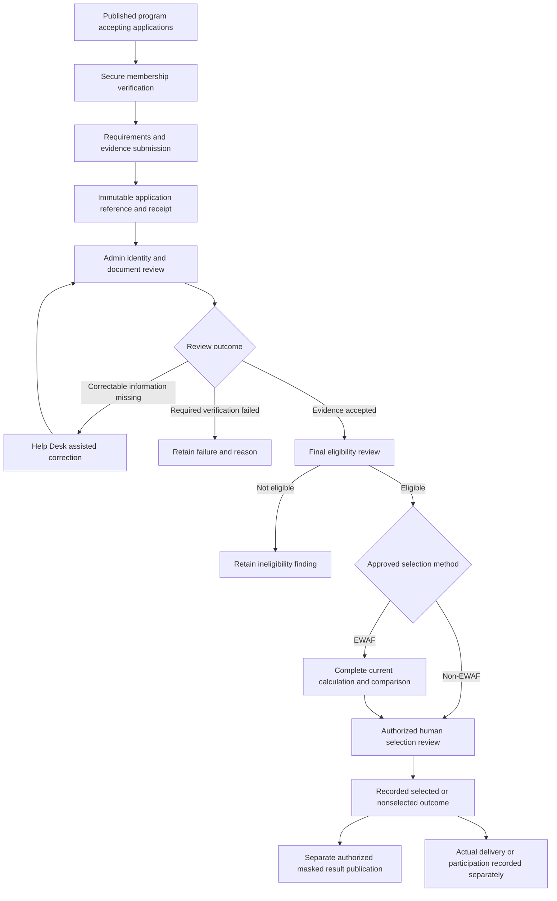
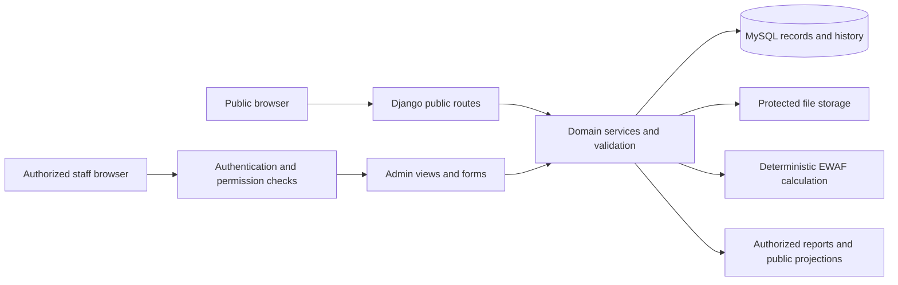

# Santolan PWD System — Overall System Specification

**Full project title:** A Web-Based Records Management and Assistance Program Analytics System Using an Equity Weighted Analytics Framework (EWAF) for the Barangay Santolan PWD Association.

**Prepared:** October 22, 2026  
**Organization:** Barangay Santolan PWD Association  
**Application:** `santolan-pwd-system`  
**Document scope:** System purpose, objectives, users, features, workflows, business rules, calculations, data, architecture, security, accessibility, operation, and remaining requirements.  
**Source checkpoint:** Repository commit `776cac5`, dated October 22, 2026, together with the governing requirements and dated validation records.  
**Recorded accepted milestone:** 70%, as defined by the project owner; this document does not change that milestone.

The Santolan PWD System helps the Association maintain official member records, process assistance-program applications, review evidence, support reasoned beneficiary decisions, record assistance actually received, and publish approved community information. It combines a public information website with a secured administrative workspace. EWAF provides reproducible numerical decision support under approved program rules; authorized people remain responsible for verification, eligibility, selection, and publication.

This is a consolidated description of the system and its intended scope. The [authoritative target specification](../CURRENT_SYSTEM_SPECIFICATION.md), confirmed amendments, and recorded decisions continue to govern policy. Features found in source code are identified separately from accepted workflows, optional test environments, and requirements awaiting approval. No application database was inspected, migrated, or changed to prepare this document, and application tests were not rerun.

## Contents

1. [System overview](#1-system-overview)
2. [Objectives and intended benefits](#2-objectives-and-intended-benefits)
3. [Scope and implementation status](#3-scope-and-implementation-status)
4. [Users and responsibilities](#4-users-and-responsibilities)
5. [Public Information Portal](#5-public-information-portal)
6. [Administrative workspace](#6-administrative-workspace)
7. [End-to-end workflows](#7-end-to-end-workflows)
8. [EWAF methodology and controls](#8-ewaf-methodology-and-controls)
9. [Data and records](#9-data-and-records)
10. [Core business rules](#10-core-business-rules)
11. [Architecture and technology](#11-architecture-and-technology)
12. [Security, privacy, and accessibility](#12-security-privacy-and-accessibility)
13. [Inputs, outputs, and interfaces](#13-inputs-outputs-and-interfaces)
14. [Operation and maintenance](#14-operation-and-maintenance)
15. [Remaining work and acceptance](#15-remaining-work-and-acceptance)
16. [Terminology and source references](#16-terminology-and-source-references)

## 1. System overview

### 1.1 Purpose

The system provides a central place for the Association to organize membership, documents, programs, applications, decisions, and assistance history. It connects administrative records with a public website so that community members can read approved information and verified Association members can apply to published programs without creating an account.

Its main operational distinction is between **a record of a request**, **a verified qualification**, **a numerical assessment**, **an authorized decision**, and **actual delivery**. Each has its own evidence, permissions, and history. An application reference does not mean that the applicant has been approved; selection does not mean that assistance has already been received.

### 1.2 What the system does

- Records and reviews membership applications submitted in person at the Association Help Desk.
- Maintains an internal directory of official members and their protected information.
- Stores private supporting documents and records verification and corrections.
- Publishes Association information, announcements, programs, events, annual observances, and authorized results.
- Accepts program applications from verified members through a controlled, login-free flow.
- Supports manual photo/document review and final program eligibility assessment.
- Provides configurable EWAF calculation and comparison code, subject to the applicable setup, evidence, policy, and acceptance requirements.
- Records separate human beneficiary decisions and assistance releases.
- Produces permission-controlled reports and exports from retained records.
- Preserves revisions, reasons, actors, timestamps, and historical evidence for accountability.

### 1.3 Problems addressed

The design addresses fragmented records, repeated collection of the same evidence, difficulty tracing decisions, inconsistent treatment of applications, and confusion between approval and assistance actually delivered. It also supports clearer public guidance while keeping personal and sensitive information private.

These are design objectives. The project has not established a measured reduction in processing time, a quantified improvement in fairness, or complete production readiness merely by implementing these screens.

## 2. Objectives and intended benefits

### 2.1 General objective

Develop a web-based records management and assistance-program analytics system that helps the Barangay Santolan PWD Association manage reliable records, process applications consistently, support transparent and explainable decisions, and communicate approved information accessibly.

### 2.2 Specific objectives

| Objective | Intended system behavior |
| --- | --- |
| Centralize official records | Maintain member, intake, evidence, program, application, decision, and release records with clear relationships. |
| Support onsite membership processing | Let authorized personnel encode, review, and decide membership intakes while preserving manual verification. |
| Improve access to information | Provide public requirements, schedules, instructions, announcements, Results, and Help Desk guidance. |
| Simplify legitimate applications | Verify existing members without accounts and reuse applicable, current verified evidence. |
| Separate evidence from conclusions | Record what was submitted, what was verified, whether qualifications were met, and what was decided. |
| Support consistent numerical assessment | Apply the same authorized EWAF configuration to the complete applicable eligible pool and retain calculation traces. |
| Preserve human accountability | Require authorized, reasoned review and selection; calculations do not automatically approve beneficiaries. |
| Track actual assistance | Record confirmed receipt separately from application, approval, selection, and attendance. |
| Protect privacy | Restrict private records and publish only an explicitly reviewed public projection. |
| Preserve traceability | Retain original evidence, corrections, configuration versions, calculations, decisions, and publication history. |
| Support accessible use | Provide understandable forms, keyboard access, readable layouts, display controls, and human assistance. |
| Support institutional reporting | Provide filtered records and exports with separate application, selection, and actual-release measures. |

### 2.3 Intended beneficiaries

Association personnel gain an organized workspace for daily processing and review. PWD members gain clearer application instructions and a submission receipt. The general public can read approved information without accessing private records. Authorized leadership can inspect evidence and reports when planning programs and reviewing service delivery.

## 3. Scope and implementation status

### 3.1 How to read feature status

- **Validated baseline:** supported by dated local validation of the relevant workflow. This does not certify all later changes or production deployment.
- **Implemented in source:** routes, models, services, or templates exist in the October 22 checkout. Actual availability depends on database setup, permissions, configuration, and the environment.
- **Optional/test integration:** implemented for a separately configured test or demonstration environment; not automatically active in ordinary settings.
- **Target/pending:** required or proposed behavior that still needs implementation, policy resolution, or acceptance.

The October 10 master and October 16 guide predate important code additions. Conversely, the presence of newer code does not prove that the working database has its tables or that the Association has approved its real operating policies.

### 3.2 Feature status matrix

| Area | Status at this checkpoint | Boundary |
| --- | --- | --- |
| Django/MySQL foundation and staff authentication | Validated baseline; retained in source | Production hosting, recovery, and institutional access acceptance are separate. |
| Seven public sections and eight Admin groups | Validated October 10; retained and subsequently extended | Links and actions depend on permissions and available setup. |
| Onsite membership and official member creation | Validated baseline; additional profile fields exist in source | Public membership remains guidance only. Exact physical-item and alternative-document enforcement is not established by the checklist display. |
| Private documents, manual PRPWD, member corrections | Validated baseline; extended source controls | Government review remains manual and external. |
| Program publication, requirements, member verification, receipts | Validated baseline | Ordinary application flow still requires calendar-photo evidence. |
| Photo review, eligibility, non-EWAF selection, actual releases | Validated baseline | Required reviews, current evidence, closing rules, and slot limits apply. |
| Dedicated Results, masked announcements, CMS | Validated baseline extension | Publication requires a current reviewed revision and explicit authorization. |
| Manual PDAO program approvals and protected terms | Dated implementation evidence and source | This records external approval; it is not a PDAO approval portal. Broader enforcement/revision policy remains scoped. |
| Annual observance calendar and publishing tools | Implemented with disposable-database validation | Persistent editing requires its schema; the launcher can defer the reviewed migration. Current database setup was not checked here. |
| EWAF evidence, configuration diagnostics, and historical records | Implemented with dated validation | Evidence readiness and mathematical consistency alone do not authorize operational use. |
| Four-criterion operational EWAF, decisions, and downstream integration | Implemented in the newer source | Requires operational tables, current authorized policy, verified complete inputs, permissions, and acceptance. Earlier development-only validation is not certification of this newer path. |
| Members, applications, programs, and assistance reports | Implemented in source, including CSV, XLSX, and PDF | These are specific report families, not the full target analytics/report catalog. |
| Program-specific socioeconomic source collection and revised verification | Optional/test integration in `program_intake` | Absent from ordinary `INSTALLED_APPS`; enabled in dedicated testing settings. It does not silently replace the approved ordinary verification flow. |
| Dashboard analytics and comprehensive action center | Target/pending beyond current overview and links | No complete statistical analytics dashboard is established by the current dashboard view. |
| Conditional photo/accessible-alternative application lifecycle | Target/pending | Do not interpret an unimplemented route as permission to skip identity review. |
| Optional public RSVP and Gemini help assistant | Proposed/pending | Neither is a generally approved operating feature. |

### 3.3 Explicit exclusions

The system does not provide public membership self-registration, member accounts or inboxes, automated government/PDAO approval, PWD ID issuance, automatic cash disbursement, facial recognition, medical diagnosis, or AI beneficiary selection. A public reference-status or QR tracker is retired. Native mobile applications, SMS/email notifications, and additional external integrations require separate scope decisions.

## 4. Users and responsibilities

| Actor | Responsibilities and permitted interaction |
| --- | --- |
| General public / nonmember | Browse published information, read membership requirements, and contact or visit the Help Desk. Cannot submit a member-only program application without verification. |
| Association member | Has an official internal member record. Can use the permitted program verification/application process without a username or password. |
| Verified member | Has passed the secure check for a particular application flow. Verification does not expose an internal profile or create an account. |
| Applicant | A member with a submitted application for a particular program. May be awaiting review, eligible, ineligible, selected, or not selected. |
| Authorized Admin personnel | Encode onsite intakes, review evidence, maintain records, manage content/programs, and perform decisions or reporting only within assigned permissions. |
| Technical superuser | Manages user/group administration and technical privileges. This is an administrative capability, not a separate Association business role. |
| External PDAO/registry authority | Performs government processes outside the application. Association personnel may record permitted manual verification or external approval evidence. |

Admin duties can be divided through Django Groups and permissions. The specification does not require separate Treasurer, Officer, or Auditor login types. Access to a member record does not automatically grant authority to change eligibility, lock EWAF policy, select beneficiaries, publish results, or export every private field.

## 5. Public Information Portal

The main navigation contains exactly **Home, About, Announcements, Events, Programs, Results, Membership**, in that order.

| Section | Purpose and content |
| --- | --- |
| Home | Published introduction, Association information, program availability, announcements, and guidance for membership and applications. |
| About | Approved background, purpose, services, mission/vision, and other authorized organizational content. |
| Announcements | Published news, program/event notices, and authorized result notices linking to Results. |
| Events | Current source renders a January-to-December annual-observance grid. Scheduled Association event management/detail routes are retained separately. The broader target also includes upcoming/past activities and approved recaps. |
| Programs | Published program information, requirements, dates, benefits, availability, and the application entry point when the program is open and ready. |
| Results | Current authorized, privacy-masked program outcomes, program context, and private Help Desk clarification guidance. |
| Membership | The confirmed Association checklist, in-person process, and separately labeled PDAO guidance where displayed. |

Supporting links provide Help Desk/contact information, FAQs, privacy, accessibility, application guidance, and EWAF explanations. Some supporting routes reuse Home sections. These links are not additional main navigation sections.

Public content must use approved institutional information. Missing official contact details, office hours, dates, or policies must not be filled with invented values. Program deadlines should come from their actual program records.

### 5.1 Public application access

Members open an available program, complete secure membership verification, submit the required information/evidence, and receive a reference. The ordinary approved verification uses **member/control number, name, birthdate, and contact number**, with conservative normalization and generic failures.

The optional testing integration uses a different member-match contract and program-specific source collection. Because ordinary settings do not enable it, it is documented as an integration boundary rather than a new universal verification policy.

### 5.2 Public result privacy

The approved display uses fixed initials masks, such as `J*** D*** C***`, and only the final four reference characters, such as `****0123`. Identical masked entries remain identical and receive clarification guidance; the system must not reveal additional characters to resolve ambiguity.

Published entries do not expose full names/references, member numbers, contacts, addresses, birthdates, disability/medical details, documents, photographs, financial circumstances, private reasons, scores, ranks, or criterion breakdowns. Public ordering of masked names is not an EWAF ranking. Masking still requires contextual disclosure review, especially for small groups.

## 6. Administrative workspace

The workspace has eight permission-aware navigation groups. These groups organize existing Django apps; they do not imply eight independent databases or eight separate business roles.

### 6.1 Dashboard

The current dashboard provides task links for membership reviews, application/photo review, member records, programs, content, assistance, and account administration. It displays account access information and links to the public site.

The full target adds actual-record overview metrics, charts, and an action center for outstanding reviews, evidence, configuration readiness, deadlines, and publication. Those statistical features should not be claimed from the present navigation-oriented dashboard alone.

### 6.2 Members

Features include onsite registration, membership review, the official member directory, private evidence access, profile corrections, active/inactive/archive handling, and retained history.

The current data model supports structured name components, contact and address details, birthdate, member/control number, disability classifications and related information, education, employment, income-related fields, and dependents. These are private records; having a field does not authorize its use as a scoring criterion or public disclosure.

**Confirmed Association membership checklist:**

1. Membership Application Form.
2. One **2×2 ID picture**.
3. **Birth Certificate OR Marriage Certificate**.
4. **Voter's Certificate**.
5. One **long envelope**, brought physically to the Help Desk.

The civil documents are alternatives. The envelope is not a mandatory digital upload. Manual PRPWD/PDAO review remains separate from Association document completeness. A PDAO PWD ID must not be inferred as an extra Association membership prerequisite.

**Separate owner-supplied PDAO guidance:** the recorded list contains the PDAO form, one **1×1** picture, whole-body updated-calendar proof of life, a Medical Certificate with final diagnosis/functional limitation/doctor's name/license number, Birth OR Marriage Certificate, and Voter's ID OR Voter's Certificate OR National ID. Surrender of the original old/expired PWD ID is a separate renewal-only item. These are the project's recorded guidance requirements, not an independent verification of current issuing-office policy.

The published checklist and Admin guidance have validation evidence. Full handling of originals, copies, alternative-document groups, physical receipts, validity periods, and additional substitutions remains subject to the applicable approved policy and OQ-27.

### 6.3 Programs & Events

**Programs** support draft creation/editing, program descriptions and benefits, application and activity dates, beneficiary slots, requirements/questions/documents, selection-method and photo instructions, publication controls, application review links, and history. Program cards and lists expose availability and review information appropriate to the user's access.

Beneficiary capacity limits selection, not the number of applications. Internal historical budget information is not an automatic eligibility rule; the scoped budget change removed Association budget editing.

**External approval and protected terms** support manual PDAO approval records, protected program-term snapshots, approval bindings, and readiness checks. Government decisions remain external. The later workflow records approved terms without introducing a PDAO login, government API, digital approval-letter upload, or an Approved Budget field. Changes to protected terms require their controlled process.

**Scheduled events** retain management, publication/detail routes, linked programs, and attendance history. New attendance follows the applicable selected-member prerequisites. Historical registrations are preserved. Open public event registration is retired; optional future RSVP requires an approved audience/intake policy.

**Annual observances** are a separate content type with month, title, recurrence description, category, description, source/legal-basis information, optional image/alt text, publication state, revisions, and audits. Admin can prepare drafts, review, publish, withdraw, archive, and restore to draft when the schema and permissions are available. Reference entries are not automatically saved or published. An annual awareness card does not create a scheduled event, attendance, RSVP, or assistance receipt.

### 6.4 Applications & Verification

This group provides program application lists and detail/review screens, full-reference search where supported, private submitted documents, current photo review, eligibility assessment, assisted corrections, and EWAF criterion evidence/readiness.

The current ordinary route requires a calendar photo, stores it privately, and relies on manual review. Photo outcomes include Pending, Verified, Needs Resubmission, and Rejected. A rejected photo is not the same as program ineligibility. A correctable missing document is not automatically a final rejection.

Document reuse requires applicable verified evidence and provenance. Relevant source/evidence replacements can invalidate dependent findings. Help Desk corrections preserve the issued reference and old evidence; exceptional reopening of terminal cases remains a separate policy question.

The optional `program_intake` integration adds a program-specific socioeconomic document review and collection of supported SI/ES/PA/ND sources. Its review records preserve source, configuration, observation period, state, reason, and predecessor. Ordinary settings do not activate this integration.

### 6.5 EWAF & Selection

The newer source provides an EWAF program workspace with configuration drafts, weight proposals and mathematical preview, authorization/locking, complete-pool calculation, criterion traces, descending score comparison, calculation history, and reasoned human decisions. Earlier evidence, AHP diagnostics, synthetic development tools, and historical five-criterion records remain preserved.

Actual use requires the relevant operational schema, permissions, current program approval/terms, a complete authorized evidence/scoring policy, and verified inputs. A visible route or a successful mathematical preview does not establish those conditions. Details are in [Section 8](#8-ewaf-methodology-and-controls).

Assistance release screens record actual delivery and reasoned void corrections. They do not transfer funds. The newer code connects an EWAF selection to release validation; non-EWAF programs use their existing authorized decision workflow.

### 6.6 Announcements & CMS

General announcements support drafting, editing, preview/review, publication, withdrawal, and retained history. CMS manages supported public information through drafts and explicit publication.

Official program results use a separate sequence: prepare an immutable result revision, inspect the exact masked projection, review privacy, and explicitly publish. Results pages and linked announcements reuse that projection. Source freshness checks withhold obsolete or unauthorized results. Closing an application window never automatically publishes an applicant list.

The newest source includes EWAF result-projection integration. It requires current complete calculations and final decisions for all eligible applicants before publication, in addition to the existing publication controls. This is newer than the validation notes that described only non-EWAF publication.

The Gemini public help assistant remains proposed. If approved later, its scope must be limited to approved public information with a human Help Desk fallback; it cannot verify members or access private evidence to make decisions.

### 6.7 Reports & Exports

Four report families are implemented in the current source:

| Report | Main information |
| --- | --- |
| Members | Control number, member name, joining date, and status. |
| Applications | Reference, member, program, submission date/status, and separately permission-controlled eligibility, selection, release-approval, and actual-assistance fields. |
| Programs | Program, assistance type, creation/application-close dates, slots, and status. |
| Assistance | Recipient, program, assistance description/type, receipt date/reference, and received/voided state. |

Reports support applicable date, program, status, and assistance-type filters, paginated display, and CSV, Excel `.xlsx`, and PDF exports. View/export access is recorded. Exports are private responses; CSV and XLSX generation handle text values to reduce spreadsheet-formula injection risk.

Broader demographic analytics, attendance reports, EWAF analytical summaries, monthly/year-end packages, and treasurer-related reports remain target scope where supported. Existing report rows are records of state/history, not substitutes for service-level checks that authorize a new release or decision.

### 6.8 Administration

Administration covers accounts, Groups/permissions, document definitions and requirements, registration/reference settings, sign-in activity, and administrative change records. Technical user/group administration is restricted to superusers; ordinary staff receive only necessary business permissions.

Workflow-specific audits also appear within individual records. The presence of those logs does not establish a complete unified Audit Trail interface, automatic backup console, or finished retention-management product.

## 7. End-to-end workflows

### 7.1 Onsite membership

1. A person reads the public membership instructions.
2. The person brings the applicable Association requirements to the Help Desk.
3. An authorized Admin encodes the intake and permitted evidence.
4. Admin checks document completeness and performs applicable manual registry review through the configured reference-link procedure.
5. An authorized reviewer records the membership decision and reason.
6. Approved intake creates the official Member record.
7. Later corrections/status changes retain history and private evidence.

This process creates an Association record, not a website member account or government PWD ID.

### 7.2 Program preparation

1. Admin creates a draft with requirements, dates, capacity, benefit, and selection method.
2. Applicable external approval and protected terms are recorded through the approved process.
3. Identity-evidence instructions and mandatory qualifications are authorized.
4. For an EWAF program, the target requires complete approved locked rules before application opening.
5. Authorized publication exposes the appropriate program information.
6. The application entry point checks the actual window and readiness, rather than assuming every published program accepts submissions.

The pre-opening EWAF requirement remains an acceptance obligation. Its complete enforcement across ordinary and optional intake paths must be verified; the existence of a configuration-locking screen alone is insufficient.

### 7.3 Application, review, and processing



The diagram summarizes the intended processing relationships. Conditional no-photo/alternative-evidence routes remain pending; an EWAF step can be used only when its operating prerequisites are satisfied. Publication and actual delivery are distinct actions and do not automatically trigger one another.

### 7.4 Important state distinctions

| Term/state | Meaning |
| --- | --- |
| Membership verified | The applicant matched the official membership record for this flow. |
| Submitted | An application and immutable reference were created successfully. |
| Pending photo verification | Current required photo evidence awaits manual review. |
| Needs information | A correctable deficiency requires completion or reassessment. |
| Verification failed | Required identity evidence failed the applicable review. |
| Eligible | Current mandatory program qualifications/evidence passed the required review. |
| Ineligible | A confirmed mandatory qualification was not met under approved rules. |
| Calculated / compared | Accepted inputs were processed under a retained configuration; this is not a beneficiary decision. |
| Selected / not selected | An authorized human recorded the relevant beneficiary outcome. |
| Deferred | A human decision still requires review; it is not an approved waitlist position. |
| Actually assisted | A successful, non-voided release/receipt exists. |
| Attended | Actual event participation was recorded; it is not an assistance release. |

The target lifecycle includes `EWAF_READY`, `EWAF_PROCESSED`, `RANKED`, `WAITLISTED`, `COMPLETED`, and `CLOSED` where applicable. An enum value does not prove that its full workflow is active. In particular, the newer operational EWAF code retains calculation and decision records separately and leaves numerical `business_rank` unset; it must not be described as automatically assigning every target lifecycle state. Waitlisting requires an approved policy.

### 7.5 References and receipts

The ordinary reference format is `SPWDA-YYYY-PRGdddddd-NNNNNNNNNN`, allocated atomically per program/year. Existing issued identifiers remain unchanged. Repeated submission attempts must not create duplicate applications or new references for the same member/program.

The receipt explains that submission does not guarantee eligibility or selection and directs applicants to Results, Announcements, and the Help Desk. Reference possession is not a credential for private record lookup or editing. A future random reference format remains a separate decision.

### 7.6 Actual assistance and corrections

Authorized personnel record a release only after actual delivery, with relevant benefit/type, date, receipt/reference, and reason. One current successful release per application is retained under the existing policy. An incorrect release is voided with a reason while keeping its original history.

Previous Assistance Received uses confirmed, non-voided actual releases within the authorized measurement scope. Applications, selections without delivery, and event attendance do not count. Source changes can require renewed review and recalculation; they must not rewrite the original calculation or receipt.

## 8. EWAF methodology and controls

### 8.1 Purpose and criterion versions

EWAF means **Equity Weighted Analytics Framework**. It combines approved criterion measurements using AHP-derived weights, Min–Max normalization, and a weighted sum. It supports explainable comparison; it does not prove that a policy is fair, diagnose disability, or automatically select beneficiaries.

Two criterion contexts must be kept distinct:

| Context | Scored criteria | Treatment of Program Relevance |
| --- | --- | --- |
| October 10 workbook/master and retained historical calculations | PA, SI, ES, ND, PR | PR contributes a numerical criterion under that historical/reference model. |
| Later four-criterion amendment and newer implementation | SI, ES, PA, ND | PR is a mandatory program-specific eligibility assessment, outside the weighted score. |

The later amendment applies to specifically authorized programs; its actual authority, dates, program scope, and operating definitions must be recorded. Do not reinterpret old five-criterion runs using four criteria, or assume that the new code approves a policy for every program.

| Code | Meaning | Required interpretation |
| --- | --- | --- |
| SI | Socioeconomic Indicator | Approved measure, evidence, unit/encoding, observation period, bounds, and direction. An income field alone is not an approved scoring rule. |
| ES | Employment Status | Approved categories and numeric mapping, based on current supported evidence. |
| PA | Previous Assistance Received | Confirmed, non-voided actual release history with an approved program scope and period. The current operational service supports ledger-count measurement. |
| ND | Number of Dependents | Approved dependent definition, scope, evidence, and counting rule. |
| PR | Program Relevance | In the newer four-criterion path, documented functional-need, consent, and accessible-alternative rubric findings rather than a numerical contribution. |

Disability type and medical severity are not EWAF score criteria. Missing or disputed evidence cannot silently become zero, maximum need, or a favorable assumed value.

### 8.2 AHP weight calculation

For an authorized reciprocal pairwise matrix `A` with `n` criteria:

```text
Column total:               s[j] = sum over i of A[i,j]
Normalized matrix:         N[i,j] = A[i,j] / s[j]
Priority weight:           w[i] = (sum over j of N[i,j]) / n
Weighted sum vector:       v[i] = sum over j of A[i,j] * w[j]
Consistency vector:        c[i] = v[i] / w[i]
Maximum eigenvalue estimate: lambda = average(c[i])
Consistency Index:         CI = (lambda - n) / (n - 1)
Consistency Ratio:         CR = CI / RI[n]
```

Matrix normalization derives weights. It is different from normalization of applicant values. Four criteria require six independent pairwise comparisons; the historical five-criterion model requires ten.

The retained reference uses RI = 1.12 for five criteria and RI = 0.90 for four. The newer operational validator requires `0 <= CR < 0.10`. These checks measure mathematical consistency; they do not supply institutional authorization or validate the substantive meaning of the criteria.

The newer interface can preview a weight proposal and retain its provenance. Effective weights remain derived and reviewed through the configuration workflow; a proposal preview is not a saved authorization or a manual edit of an applicant's final score.

### 8.3 Applicant normalization and weighted score

For accepted value `x`, approved lower bound `L`, and upper bound `U`, with `U > L`:

```text
Benefit direction: z = (x - L) / (U - L)
Inverse direction: z = (U - x) / (U - L)

Criterion contribution = weight * z
EWS on 0–1 scale        = sum of criterion contributions
EWS on 0–100 scale      = 100 * EWS on 0–1 scale
```

The approved configuration determines direction and encoding. The original workbook increases normalized income and PA values as their raw values increase; earlier policy language described inverse directions. Neither interpretation becomes an approved default through this document.

The newer operational implementation requires explicit bounds and blocks unsupported, missing, stale, disputed, or out-of-range inputs rather than silently imputing/clipping them. Need classification is either explicitly disabled or defined with approved, contiguous thresholds. Workbook sample labels are not automatic production thresholds.

### 8.4 Configuration and complete-pool processing

A usable configuration records its version/predecessor, program, authority reference, approval/effective dates, evidence policy, criterion definitions, encodings, directions, bounds, AHP judgments/derived validation, PA scope/period, PR eligibility rubric, classification choice, selection/tie procedure, actor, and reason.

The newer source requires a latest authorized `LOCKED` configuration whose source and evidence-policy bindings are current. It checks program policy authorization, positive approved capacity, protected terms, and evidence compatibility. Calculations begin after the application period closes and account for the retained application inventory. Unresolved in-scope review/evidence blocks the complete calculation rather than silently omitting applicants.

Each run retains the source snapshot, configuration, accepted inputs, normalized values, weights, contributions, scores, validity boundary, request identity, and predecessor. Recalculation creates a new version; it does not overwrite history. Protected use rechecks source freshness, policy/evidence validity, and authorization.

The current operational code has an engineering ceiling of **2,000 retained applications per processing pool**. This is not an application quota, beneficiary cap, or demonstrated production performance guarantee. Earlier disposable-development implementations had different limits and must not be described as the current operational limit.

### 8.5 Comparison, ties, and human selection

The newer operational results compare exact stored scores in descending order and retain equal-score information. They do not assign a business rank or break ties by member ID, submission time, or reference number.

Human decisions are separately recorded as Selected, Not Selected, or Deferred, with actor, reason, revision, and calculation provenance. Final decisions involving exact ties follow the approved hold or reasoned-human procedure. Slot constraints apply to selection. No screen should overwrite a generated score, manipulate rank order, or disguise a discretionary decision as a calculated result.

The current source connects eligible, current EWAF decisions to release and masked-publication checks. Real use still depends on setup and approved rules. Its presence does not advance the recorded 70% milestone or establish representative user acceptance.

### 8.6 Recalculation boundary

The target calls for consistent recalculation of all affected eligible applications after authorized rule or source changes, preserving prior versions. The newer operational source offers explicit complete-pool generation/recalculation and rejects stale use. Automatic background recalculation and every target consumer/revision scenario are not established by that mechanism alone.

Changed rules after opening, expired evidence, cross-program assistance, previously selected cases, and already published results need an approved review/revision policy. A failed or stale replacement must not be treated as a successful current calculation.

### 8.7 Workbook evidence and limitations

The original workbook is a methodology reference, not a reliable executable production engine. Its recorded formula/cache ledger shows:

- `C29:C33` average empty ranges and contain cached `#DIV/0!` errors.
- Several normalized matrices, weights, consistency values, and scoring inputs are pasted literal copies with no live dependency on earlier cells.
- `H86` contains the 0–1 weighted score; the intended 0–100 presentation requires multiplication by 100.
- The workbook's sample score, weights, income values, directions, and printed classification bands do not approve real policies.

Independent arithmetic and versioned engines must derive results from accepted inputs. Stored Excel caches must not be described as a freshly recalculated workbook. The original workbook and historical results remain unchanged.

## 9. Data and records

### 9.1 Principal record groups

| Record group | Purpose |
| --- | --- |
| Users, Groups, permissions, sessions | Staff identity, authentication, and action authorization. |
| Membership application and membership events | Onsite intake, manual verification, decision, reasons, and history. |
| Member and member events | Official membership profile, control number, status, corrections, and provenance. |
| Document types, requirements, documents, verifications | Configurable evidence definitions, private uploads, review findings, validity, and reuse. |
| Program, requirements, logs | Program terms, dates, slots, method, evidence/questions, publication, and changes. |
| PDAO approval, term revisions, approval bindings | Manual external approval facts and the precise protected terms they support. |
| Program application, counters, snapshots | One retained member/program application, immutable receipt identifier, submitted information, and version context. |
| Application photos, photo reviews, document revisions | Private identity/evidence versions and manual review history. |
| Assistance case, releases, logs | Eligibility findings, applicable decisions, actual delivery, and void history. |
| EWAF evidence/configuration/calculation/decision records | Versioned definitions, verified findings, mathematical traces, comparisons, decisions, and historical runs. |
| Event, registration, attendance, logs | Scheduled activities and retained participation records. |
| Annual observance, revision, audit | Recurring awareness content and its publication history, separate from scheduled events. |
| Announcement, result revision, public content, content revision | Approved public information and privacy-safe result projections. |
| Security and administrative/workflow logs | Accountability for access and protected operations. |
| Optional intake source reviews | Program-specific socioeconomic evidence and source integration in its configured environment. |

### 9.2 Main relationships

An approved membership intake establishes one official member. A member may have many program applications, but only one retained application per program. A program has requirements, applications, approval/term history, and potentially many EWAF configurations and runs. An application links its evidence, reviews, eligibility, decisions, and releases. A published result is a reviewed projection of authorized outcomes rather than a public copy of the internal application table.

### 9.3 Data integrity requirements

Preserve unique member/control numbers and application references, explicit relationships, version checks, protected historical references, and transactional business/audit writes. Do not physically discard history to correct a current state. Keep archived/inactive membership distinct from deletion; keep voided assistance distinct from a successful receipt.

Raw, encoded, normalized, and displayed values must remain distinguishable. A stored declaration, verified evidence finding, eligibility result, numerical input, and final decision are different records even if their screens show related information.

## 10. Core business rules

| ID | Rule |
| --- | --- |
| BR-01 | Association membership is processed onsite by authorized personnel; public guidance is not online membership registration. |
| BR-02 | Members have no system accounts, passwords, profile portal, or notification inbox. |
| BR-03 | Association membership completeness, manual registry review, and government ID processing remain separate. |
| BR-04 | Only a securely verified member can continue through a member-only application flow. Generic failure messages must not disclose matching fields or member existence. |
| BR-05 | Submission rechecks current membership, program window, versions, and applicable requirements. |
| BR-06 | One retained application per member/program and immutable issued references are preserved, including retries and corrections. |
| BR-07 | Required identity/document review precedes final eligibility and applicable calculation/selection. Correctable deficiencies retain a completion path. |
| BR-08 | Eligibility, calculation/comparison, selection, publication, attendance, and actual release are separate facts. |
| BR-09 | Slots constrain beneficiary decisions, not how many members may submit applications. |
| BR-10 | EWAF uses authorized versioned rules and accepted evidence consistently across the applicable eligible pool. |
| BR-11 | Disability type/medical severity is not an EWAF numerical criterion; a relevant mandatory qualification needs explicit program authority. |
| BR-12 | Generated scores cannot be manually edited or hidden adjustments inserted. Human decisions retain their own reasons and provenance. |
| BR-13 | Previous assistance counts only supported confirmed, non-voided actual releases within the approved scope. |
| BR-14 | Result preparation is private; publication needs explicit authorization and a current privacy-safe projection. Application closure is not publication authorization. |
| BR-15 | Full references never authorize public private-record lookup or editing. |
| BR-16 | Corrections retain old evidence, configuration, calculations, decisions, and audits; stale dependent work must be reassessed. |
| BR-17 | Missing institutional policies, dates, thresholds, mappings, or external approvals are not supplied by sample data. |

These identifiers organize this document only. The governing numbered rules remain in the vault's Business Rules and Decisions notes.

## 11. Architecture and technology

### 11.1 Application architecture

The system is a modular Django application with server-rendered HTML and Bootstrap styling. Django views/forms handle requests and validation, service modules own business operations, and the ORM/migrations define MySQL persistence. Public projections and permission-checked private access keep public content separate from internal records.



An internal API may be introduced where needed, but this is not an API-first single-page application. No direct government database integration is required.

### 11.2 Technology inventory

| Layer | Technology in the repository / target |
| --- | --- |
| Backend | Python and Django; the current dependency file pins Django 5.2.17. |
| Database | Native MySQL, Django ORM, migrations, `mysqlclient`, and `utf8mb4`. |
| User interface | Django templates, HTML, Bootstrap, CSS, and JavaScript. |
| Images | Pillow and controlled image/file validation. |
| Reports | Python CSV output, `openpyxl` for XLSX, and ReportLab-based PDF generation. |
| Configuration | Environment variables and `python-dotenv`; secrets remain outside source control. |
| Analytics presentation | Chart.js is part of the target stack; a complete chart dashboard is not established by current dashboard code. |
| Automated checks | Django tests, disposable MySQL runners, and Playwright/Chrome browser harnesses. |
| Time handling | Timezone-aware Django values with `Asia/Manila` configured for the application. |

Dependency versions describe this checkout, not a recommendation to upgrade or a statement about the newest upstream release.

### 11.3 Repository organization

| Location | Responsibility |
| --- | --- |
| `config/` | Settings, root routing, environment-specific configuration, WSGI/ASGI. |
| `accounts/` | Staff authentication, account access, and authority controls. |
| `membership/`, `members/`, `documents/` | Onsite intake, official records, private evidence, and verification. |
| `programs/`, `assistance/` | Program/application lifecycle, approvals, eligibility, decisions, and releases. |
| `ewaf/` | Historical/reference engines, evidence, configuration, calculation, comparison, and newer operational services. |
| `events/` | Scheduled events, attendance, and annual observances. |
| `announcements/`, `core/` | Public content, Results publication, common workspace, and shared infrastructure. |
| `reports/`, `analytics/`, `audit/` | Current report families, later analytics scope, and security/audit support. |
| `program_intake/`, `main_testing/` | Optional source/intake integration and dedicated fictional testing workflows. |
| `templates/`, `static/` | Shared layouts, domain screens, styles, JavaScript, and public assets. |
| App `migrations/` and tests | Versioned schema changes and behavior verification. |
| `scripts/`, `docs/` | Startup/test tooling, browser harnesses, plans, and dated validation evidence. |

## 12. Security, privacy, and accessibility

### 12.1 Access and application security

Required controls include staff-only authentication, password hashing, least-privilege permissions, server-side authorization, CSRF protection, escaped output, validated inputs, bounded login/member-verification attempts, secure sessions, and HTTPS for production.

Private evidence is delivered through permission-checked attachment views. Random storage paths are not authorization, and an unrestricted `/media/` route must not expose member documents. Uploads require type/content/size validation and safe image handling. Private responses and exports should avoid shared caching.

Sensitive values, credentials, access tokens, private uploads, and environment files must not enter public pages, source control, or routine logs. Stale forms and changed permissions must be rechecked at the protected action, rather than relying on what an earlier page displayed.

### 12.2 Privacy and disclosure

The project's privacy requirements call for transparency, legitimate purpose, proportionality, controlled access, approved notices, and retention/disposal decisions consistent with its stated Data Privacy Act framework. This specification is not a legal certification.

Public output uses an explicit field allowlist. Staff reports are private operational records, not public transparency pages. Medical, civil, identification, socioeconomic, and photo evidence stays protected. Record reuse must remain relevant to the purpose and supported by current verification.

The Association still needs recorded institutional decisions for processing grounds, retention, disposal, incident responsibilities, access assignments, and permitted disclosures. Publication of a generic checklist never authorizes publication of an applicant's proof.

### 12.3 Audit and historical protection

Auditable actions include authentication, intake/member changes, document/photo review, program policy/terms, eligibility, EWAF evidence/configurations/runs, selection, release/void, content/result publication, and report access.

Audit entries should retain the actor, time, object/version, action, reason, and appropriate protected change/evidence references. Required audits and business changes must commit together. Application guards and retained digests help protect supported workflows; they do not make a database-owner account or external filesystem writes impossible.

### 12.4 Accessibility and usability

The target is WCAG 2.2 Level AA where feasible, with gaps documented. Requirements include semantic structure, labels, accessible errors, keyboard operation, visible focus, skip navigation, sufficient contrast, meanings independent of color, responsive reflow, zoom support, readable text, useful alt text, reduced motion, and appropriately sized controls.

Existing shared controls support text sizing, contrast, reduced motion, and browser-supported reading aloud. Reading aloud supplements accessible text and screen-reader compatibility. Approved assistance and accessible evidence alternatives must be defined without bypassing necessary manual review.

Recorded browser checks cover selected layouts and interactions. They do not establish complete screen-reader coverage, WCAG certification, or representative PWD user acceptance.

### 12.5 Reliability and maintainability

The design requires transaction-safe updates, stale-write prevention, idempotent requests where applicable, retained history, meaningful failure messages, and recovery procedures for the database and private files. Performance, availability, backup frequency, retention, and recovery objectives require agreed measurements; this specification does not invent response-time or uptime guarantees.

## 13. Inputs, outputs, and interfaces

| Input | Processing | Output |
| --- | --- | --- |
| Onsite membership details and evidence | Authorized encoding, manual review, decision | Official member record or retained pending/rejected intake. |
| Member verification information | Protected server-side matching and availability/version checks | Short-lived application-flow grant or generic failure. |
| Application answers, documents, required photo | Validation and atomic submission | Retained application, immutable reference, and receipt. |
| Manual photo/document findings | Evidence and eligibility review | Current review result, explanation, history, and readiness state. |
| Approved program policy and verified EWAF inputs | AHP, normalization, weighted sum, complete-pool validation | Private versioned scores, traces, comparison, and history. |
| Authorized human review | Current evidence/run and slot checks | Separate reasoned beneficiary decision. |
| Confirmed actual delivery | Release validation and audit | Successful receipt or retained reasoned void. |
| Approved content/results | Preview, privacy review, explicit publication | Public information or masked Results projection. |
| Authorized report filters | Permission-scoped queries and export | Screen report, CSV, XLSX, or PDF with access audit. |

The primary interfaces are a web browser, the Admin workspace, the onsite Help Desk process, and approved file downloads. Manual PRPWD/PDAO reference review is an external human activity. A reference receipt is an output artifact, not a public authentication interface.

## 14. Operation and maintenance

### 14.1 Local operation

The documented local entry point is **Start System.cmd**, or:

```powershell
powershell -NoProfile -ExecutionPolicy Bypass -File scripts/run.ps1
```

Default documented local addresses are `http://127.0.0.1:8000/` for the public site and `http://127.0.0.1:8000/accounts/login/` for staff sign-in. The project-local MySQL workflow uses port 3307. These are local development addresses, not a public deployment claim.

There is no default shared administrator password. Account creation and permission assignment use the existing administrative process. Ordinary startup does not authorize new program policies or migrate every pending table.

### 14.2 Database and feature setup

The `runlocal` command permits only specifically reviewed, hash-pinned migrations to remain deferred. The current list includes annual-observance and later EWAF tables. Other unapproved pending migrations stop startup. Operational EWAF checks for its required tables; absent schema is handled as unavailable rather than silently installed.

Before applying migrations to the working database, review the exact plan, obtain the applicable authorization, back up existing data/private files, and validate the intended change using disposable MySQL. Do not use a blanket migration command to bypass the deferred-feature boundary.

### 14.3 Verification and environments

Common project checks include:

```powershell
.venv\Scripts\python.exe manage.py check --database default
.venv\Scripts\python.exe manage.py makemigrations --check --dry-run
git diff --check
```

Application tests must use a separate disposable database. The repository also provides isolated native-MySQL runners for later EWAF work and dedicated fictional demo/testing settings. Demonstration data, fixture policy, and synthetic calculation results must not be treated as real member data or approved Association decisions.

### 14.4 Deployment and maintenance requirements

Production requires explicit hosts/secrets, HTTPS, a suitable MySQL service, protected persistent media, restricted access, backups/restoration evidence, and an approved deployment process. Deployment preparation files are not proof that those services are provisioned or that the site is live.

Ongoing maintenance includes permission review, approved reference/content updates, dependency review, audit and retention management, data-quality corrections, backup/recovery checks, and regression testing after workflow changes. Database and private-media recovery must be considered together.

## 15. Remaining work and acceptance

### 15.1 Decisions and gaps requiring attention

| Area | Remaining requirement |
| --- | --- |
| EWAF operating authority | Record actual program scope, approving authority, approval/effective dates, criterion definitions, evidence rules, directions, bounds, classifications, and tie/selection procedures. |
| Five- versus four-criterion history | Preserve historical meanings and identify exactly which programs use the later PR-as-eligibility amendment. |
| Pre-opening configuration and revision | Verify complete enforcement across intake paths and settle changes after opening, affected pools, reevaluation, and previously selected/published cases. |
| Conditional identity evidence | Implement and validate approved photo, alternative, and no-additional-photo state transitions without fabricated photo verification. |
| Membership handling | Complete any needed alternative-document/physical-item/original-copy enforcement under OQ-27. |
| Optional intake integration | Confirm authorization, accepted matching contract, source policy, schema, and acceptance before enabling it beyond its dedicated environment. |
| Event RSVP | Resolve audience, minimal data, capacity, cancellation, and attendance separation before introducing public intake. |
| Reports and analytics | Complete the remaining target dashboard/action-center and report categories beyond the four implemented report families. |
| Reference and disclosure policy | Preserve existing references/masks while separately deciding future random generation, expanded aggregates, retention, and clarification/appeal procedures. |
| Operations | Verify actual migration/configuration state, deployment, capacity, backup restoration, security, and recovery targets. |
| User acceptance | Obtain representative officer/PWD and assistive-technology acceptance, plus owner review of later milestones. |
| Gemini | Keep proposed until scope, privacy, cost, public-content grounding, testing, and accessible fallback are approved. |

### 15.2 Acceptance criteria for the complete system

The completed system should demonstrate, using authorized policies and a representative test environment:

1. Public visitors can reach all seven sections without gaining access to private records.
2. Membership remains onsite, uses the distinct Association checklist, and preserves manual review/history.
3. Staff permissions are enforced on direct requests and services, not only through hidden links.
4. Member verification resists enumeration and issues only bounded, program-scoped grants.
5. Submissions and retries preserve one application/reference; corrections retain old evidence.
6. Required evidence and current eligibility cannot be bypassed by an arbitrary status change.
7. Program configuration and applicable external authority are current before affected operations.
8. Independently checked EWAF calculations reproduce approved rules, block incomplete pools, preserve true ties, and retain complete traces/history.
9. Source/configuration changes invalidate dependent work and trigger the approved complete-pool reassessment/recalculation process.
10. Human selection respects slots and never modifies the calculated score.
11. Actual receipt, voids, attendance, and PA counts remain separate and correct under concurrent actions.
12. Results require explicit publication, omit private fields, and withhold stale projections.
13. Reports/exports enforce permissions and distinguish application, eligibility, selection, and actual delivery.
14. Browser, keyboard, assistive-technology, privacy, audit rollback, stale-edit, concurrency, backup/restoration, and agreed performance checks pass with retained evidence.
15. The owner and Association accept the applicable scope; code presence or documentation alone does not award a new completion percentage.

### 15.3 Evidence interpretation

The revised 70% validation records a historical 253-test run, while later notes record separate navigation, publication, membership, approval, observance, and EWAF-development checks. These runs have different dates and scopes; counts must not be added to imply a new combined acceptance result.

The October 19 operational-readiness note describes development-only EWAF and unresolved operational acceptance. October 22 source contains additional operational, reporting, and intake implementations beyond that description. This document records that source change without claiming that the earlier tests certified it, that its migrations were applied to the working database, or that the owner accepted an 80% milestone.

## 16. Terminology and source references

### 16.1 Terminology

| Term | Meaning |
| --- | --- |
| PWD | Person with disability. |
| PDAO | Persons with Disability Affairs Office; the external office associated with the project's separate government-ID/approval guidance. |
| PRPWD | The government registry reference used in the project's manual verification workflow; no automated integration is implied. |
| RBAC | Role-based access control using authorized permissions. |
| EWAF | Equity Weighted Analytics Framework. |
| AHP | Analytic Hierarchy Process, used here to derive criterion weights from pairwise comparisons. |
| WSM | Weighted Sum Model. |
| EWS | Equity Weighted Score on the retained 0–1 or displayed 0–100 scale. |
| CI / CR / RI | Consistency Index / Consistency Ratio / Random Index used in the AHP consistency check. |
| CMS | Content Management System for approved public information. |
| UAT | User acceptance testing. |
| Immutable record | A record retained without ordinary in-place alteration through supported workflows; subsequent corrections use linked history. |
| Source freshness | Whether the evidence, authority, versions, and validity on which a result depends still support its current use. |

### 16.2 Governing requirements

- [Current System Specification — October 10 target](../CURRENT_SYSTEM_SPECIFICATION.md).
- [Guide for Development](../Guide%20for%20Development.md).
- [System Master Specification index](../00%20-%20Project%20Overview/System%20Master%20Specification.md).
- [Workflow Source Register](../00%20-%20Project%20Overview/Workflow%20References/2026-10-10/Workflow%20Source%20Register.md).
- [Confirmed Membership and PDAO Requirements](../00%20-%20Project%20Overview/Workflow%20References/2026-10-10/Confirmed_Membership_and_PDAO_Requirements_2026-10-10.md).
- [Decisions, including DEC-024, DEC-025, DEC-026, and DEC-027](../00%20-%20Project%20Overview/Decisions.md).
- [Open Decisions](../00%20-%20Project%20Overview/Open%20Decisions.md).
- [October 10 Implementation Impact](../05%20-%20Development/October%2010%20Implementation%20Impact.md).
- [Workbook Formula and Cache Evidence](../00%20-%20Project%20Overview/Workflow%20References/2026-10-10/Workbook%20Formula%20and%20Cache%20Evidence.md).

Source priority remains Admin Portal V2 → Public Portal → computation workbook for mathematics → nonsuperseded requirements → historical background, with the confirmed membership amendment governing its specific subject. New implementation does not itself resolve open business policy.

### 16.3 Dated implementation and validation references

- [Revised 70% validation](docs/revised70-validation.md) and [authorized results/unified Members validation](docs/announcements-members-validation.md).
- [Public Results and seven-section navigation](docs/phase1-public-results-validation-2026-10-10.md).
- [Eight-group Admin navigation](docs/phase2-admin-navigation-validation-2026-10-10.md).
- [Confirmed membership guidance](docs/confirmed-membership-validation-2026-10-10.md).
- [Manual PDAO approval recording](docs/g06-b1a-pdao-recording-validation-2026-10-12.md) and [approved terms/binding](docs/g06-b1b1-approved-terms-validation-2026-10-12.md).
- [Annual observance persistence/publication](docs/annual-observances-persistence-validation-2026-10-17.md) and [startup deferral correction](docs/start-system-observances-fix-2026-10-17.md).
- [PR amendment validation](docs/g18-pr-amendment-validation-2026-10-18.md).
- [Stage 8 consolidated development validation](docs/stage8-consolidated-validation-2026-10-19.md).
- [EWAF operational-readiness checkpoint](docs/ewaf-operational-readiness-2026-10-19.md) and [consolidated policy decisions still needed](docs/ewaf-operational-policy-decisions-2026-10-19.md).
- [October 21 local startup catalog validation](docs/start-system-catalog-validation-2026-10-21.md).

### 16.4 Current source supporting later feature descriptions

- [Root routes](config/urls.py), [public routes](core/urls.py), and [Admin navigation](core/templatetags/workspace_navigation.py).
- [Membership checklist guidance](membership/guidance.py), [member data](members/models.py), and [document data](documents/models.py).
- [Program data and states](programs/models.py), [application workflow](programs/workflow.py), and [assistance services](assistance/services.py).
- [EWAF operational services](ewaf/operational_services.py), [policy validation/calculation](ewaf/operational_policy.py), [records](ewaf/operational_models.py), and [workspace views](ewaf/operational_views.py).
- [Result publication services](announcements/results.py) and [public Results](announcements/public_results.py).
- [Report views](reports/views.py) and [report projections/exports](reports/services.py).
- [Event views](events/views.py), [observance records](events/observance_models.py), and [event/observance services](events/services.py).
- [Ordinary settings](config/settings.py), [fictional testing settings](config/main_testing_settings.py), [optional intake access](program_intake/access.py), and [optional source-policy integration](program_intake/policy.py).
- [Local startup migration guard](core/management/commands/runlocal.py) and [dependency file](requirements.txt).

Future revisions should update feature status using both the applicable decisions and dated implementation evidence. Preserve old policy/calculation history, identify the reviewed source checkpoint, and keep deployment and acceptance claims tied to actual evidence.
