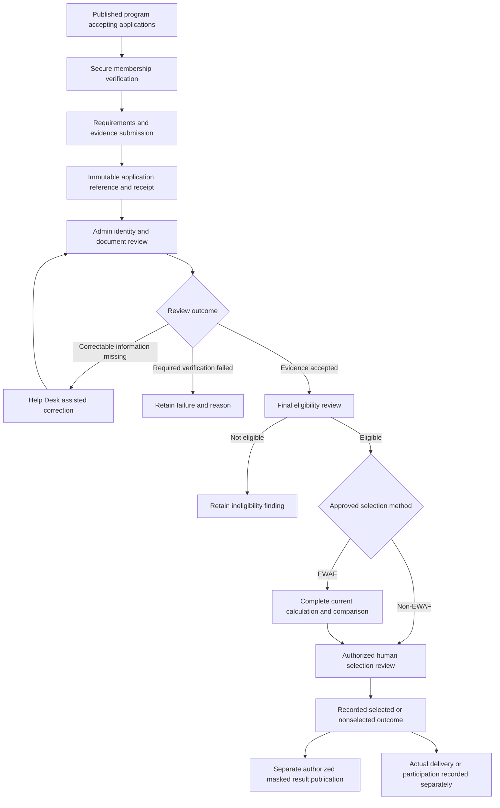
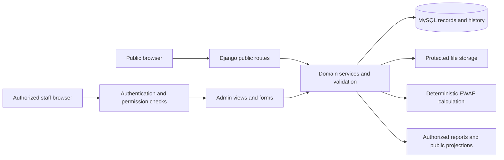

# Santolan PWD System — Overall System Specification

**Full project title:** A Web-Based Records Management and Assistance Program Analytics System Using an Equity Weighted Analytics Framework (EWAF) for the Barangay Santolan PWD Association.

**Prepared:** October 22, 2026  
**Organization:** Barangay Santolan PWD Association  
**Application:** `santolan-pwd-system`  
**Document scope:** System purpose, objectives, users, features, workflows, business rules, calculations, data, architecture, security, accessibility, operation, and remaining requirements.  
**Source checkpoint:** Repository commit `776cac5`, dated October 22, 2026, together with the governing requirements and dated validation records.  
**Recorded accepted milestone:** 70%, as defined by the project owner; this document does not change that milestone.

The Santolan PWD System helps the Association maintain official member records, process assistance-program applications, review evidence, support reasoned beneficiary decisions, record assistance actually received, and publish approved community information. It combines a public information website with a secured administrative workspace. EWAF provides reproducible numerical decision support under approved program rules; authorized people remain responsible for verification, eligibility, selection, and publication.

This is a consolidated description of the system and its intended scope. The [authoritative target specification](../CURRENT_SYSTEM_SPECIFICATION.md), confirmed amendments, and recorded decisions continue to govern policy. Features found in source code are identified separately from accepted workflows, optional test environments, and requirements awaiting approval. No application database was inspected, migrated, or changed to prepare this document, and application tests were not rerun.


<!-- BRAINSTORM_ADDITION:integration_notice:BEGIN -->
## Integration notice — additive revision

**Integration date:** October 23, 2026.  
**Base document (S):** `OVERALL_SYSTEM_SPECIFICATION.md`, prepared October 22, 2026.  
**Added requirements source (B):** `Brainstorm Final(2).pdf`, 23 pages.  
**Revision purpose:** Add the Brainstorm's public services and their necessary administrative connections to this same study without changing EWAF.

**Read the two layers separately.** The original text is retained as the recorded system baseline. Subsections explicitly marked **Added target** define the expanded requirements requested in this integration; they do not establish that code, tables, permissions, or tests already exist. Where the new intake or tracking requirement differs from an old exclusion, the additive target applies to the planned extension only. The old statement continues to describe the recorded implementation, not a prohibition on designing the extension. Section 3.4 identifies these differences explicitly.

**EWAF is protected.** Section 8 is reproduced without any text changes. This integration does not alter criterion versions, PR treatment, AHP judgments or formulas, the strict CR threshold, normalization bounds/directions, classification rules, complete-pool checks, exact-score ties, the absence of numerical business ranks, human decisions, recalculation, or historical results. Brainstorm requests that would require those changes are retained as unresolved requests, not enabled features. The same protection applies to EWAF-related business rules elsewhere in S.

**Documentation only.** No repository, working database, migration, credential, deployed service, source configuration, or accepted milestone is changed. The source checkpoint and 70% milestone above are retained, not revalidated. References in the original document to other vault notes or source-code files are inherited references; those linked files were not independently inspected for this integration.

**Source notation.** `B, pp. x–y` refers to PDF page numbers in the supplied Brainstorm. `S §x` refers to the original specification section. Editorial mapping of public functions into existing Admin groups is identified as integration organization, not a new institutional approval. Duplicated Brainstorm descriptions are consolidated. Unresolved contradictions, absent policy details, and deferred requests remain visible in Sections 3.4 and 15.5.
<!-- BRAINSTORM_ADDITION:integration_notice:END -->

## Contents

1. [System overview](#1-system-overview)
2. [Objectives and intended benefits](#2-objectives-and-intended-benefits)
3. [Scope and implementation status](#3-scope-and-implementation-status)
4. [Users and responsibilities](#4-users-and-responsibilities)
5. [Public Information Portal](#5-public-information-portal)
6. [Administrative workspace](#6-administrative-workspace)
7. [End-to-end workflows](#7-end-to-end-workflows)
8. [EWAF methodology and controls](#8-ewaf-methodology-and-controls)
9. [Data and records](#9-data-and-records)
10. [Core business rules](#10-core-business-rules)
11. [Architecture and technology](#11-architecture-and-technology)
12. [Security, privacy, and accessibility](#12-security-privacy-and-accessibility)
13. [Inputs, outputs, and interfaces](#13-inputs-outputs-and-interfaces)
14. [Operation and maintenance](#14-operation-and-maintenance)
15. [Remaining work and acceptance](#15-remaining-work-and-acceptance)
16. [Terminology and source references](#16-terminology-and-source-references)

## 1. System overview

### 1.1 Purpose

The system provides a central place for the Association to organize membership, documents, programs, applications, decisions, and assistance history. It connects administrative records with a public website so that community members can read approved information and verified Association members can apply to published programs without creating an account.

Its main operational distinction is between **a record of a request**, **a verified qualification**, **a numerical assessment**, **an authorized decision**, and **actual delivery**. Each has its own evidence, permissions, and history. An application reference does not mean that the applicant has been approved; selection does not mean that assistance has already been received.

### 1.2 What the system does

- Records and reviews membership applications submitted in person at the Association Help Desk.
- Maintains an internal directory of official members and their protected information.
- Stores private supporting documents and records verification and corrections.
- Publishes Association information, announcements, programs, events, annual observances, and authorized results.
- Accepts program applications from verified members through a controlled, login-free flow.
- Supports manual photo/document review and final program eligibility assessment.
- Provides configurable EWAF calculation and comparison code, subject to the applicable setup, evidence, policy, and acceptance requirements.
- Records separate human beneficiary decisions and assistance releases.
- Produces permission-controlled reports and exports from retained records.
- Preserves revisions, reasons, actors, timestamps, and historical evidence for accountability.

### 1.3 Problems addressed

The design addresses fragmented records, repeated collection of the same evidence, difficulty tracing decisions, inconsistent treatment of applications, and confusion between approval and assistance actually delivered. It also supports clearer public guidance while keeping personal and sensitive information private.

These are design objectives. The project has not established a measured reduction in processing time, a quantified improvement in fairness, or complete production readiness merely by implementing these screens.


<!-- BRAINSTORM_ADDITION:s1:BEGIN -->
### 1.4 Added target — expanded service access, unchanged study purpose

The same records-management study additionally supports online **pending application intake** for Association membership and separately handled PDAO PWD ID assistance, alongside printable forms and walk-in intake. These channels connect a submitted form to authenticated staff retrieval and mandatory onsite verification. They do not create a member account, confer membership upon submission, or authorize government ID issuance.

The Public Portal also adds protected application-status guidance, a member-only assistance/referral ticket, Resources & Help for all visitors, expected-attendance RSVP, information-update instructions, and evaluation-review requests. These services extend access to the Association's records and review processes; they do not replace the existing program, actual-assistance, or EWAF workflows. Public information remains distinct from permission to participate in a member-only program.

*Sources: B, pp. 1–4, 8, 10–19; S §§1.1–1.3. Status: added target.*
<!-- BRAINSTORM_ADDITION:s1:END -->

## 2. Objectives and intended benefits

### 2.1 General objective

Develop a web-based records management and assistance-program analytics system that helps the Barangay Santolan PWD Association manage reliable records, process applications consistently, support transparent and explainable decisions, and communicate approved information accessibly.

### 2.2 Specific objectives

| Objective | Intended system behavior |
| --- | --- |
| Centralize official records | Maintain member, intake, evidence, program, application, decision, and release records with clear relationships. |
| Support onsite membership processing | Let authorized personnel encode, review, and decide membership intakes while preserving manual verification. |
| Improve access to information | Provide public requirements, schedules, instructions, announcements, Results, and Help Desk guidance. |
| Simplify legitimate applications | Verify existing members without accounts and reuse applicable, current verified evidence. |
| Separate evidence from conclusions | Record what was submitted, what was verified, whether qualifications were met, and what was decided. |
| Support consistent numerical assessment | Apply the same authorized EWAF configuration to the complete applicable eligible pool and retain calculation traces. |
| Preserve human accountability | Require authorized, reasoned review and selection; calculations do not automatically approve beneficiaries. |
| Track actual assistance | Record confirmed receipt separately from application, approval, selection, and attendance. |
| Protect privacy | Restrict private records and publish only an explicitly reviewed public projection. |
| Preserve traceability | Retain original evidence, corrections, configuration versions, calculations, decisions, and publication history. |
| Support accessible use | Provide understandable forms, keyboard access, readable layouts, display controls, and human assistance. |
| Support institutional reporting | Provide filtered records and exports with separate application, selection, and actual-release measures. |

### 2.3 Intended beneficiaries

Association personnel gain an organized workspace for daily processing and review. PWD members gain clearer application instructions and a submission receipt. The general public can read approved information without accessing private records. Authorized leadership can inspect evidence and reports when planning programs and reviewing service delivery.


<!-- BRAINSTORM_ADDITION:s2:BEGIN -->
### 2.4 Added target — objective alignment

The general objective and existing specific objectives remain unchanged. The following behaviors extend them rather than define a separate study.

| Existing objective | Added behavior from the Brainstorm |
| --- | --- |
| Centralize official records | Retain pending online registrations, separate PDAO intake/forwarding records, reference receipts, and member-only referral tickets without treating them as approved membership or actual assistance. |
| Support onsite membership processing | Retrieve a previously completed form by reference during the required onsite verification, while retaining print and walk-in channels. |
| Improve access to information | Add Resources & Help, clear office/process distinctions, reviewed helplines, downloadable forms, and linked program/result notices. |
| Simplify legitimate applications | Provide status and next-action guidance, confirm current information, reuse suitable evidence, and assist corrections without requiring a conventional member account. |
| Separate evidence from conclusions | Distinguish submission, self-declaration, review, onsite readiness, membership decision, program eligibility, and final selection. |
| Preserve human accountability | Record verification and forwarding actions, correction findings, and the outcome of an applicant's evaluation-review request. |
| Protect privacy and preserve traceability | Limit tracking and public explanations to approved fields; retain protected access, historical information, and reviewed publication revisions. |
| Support accessible use | Apply the expanded accessibility requirements to intake, uploads, receipts, tracking, information updates, and review requests. |

The numerical-assessment objective, actual-assistance objective, and their existing controls are not revised. Proposed public services do not establish measured efficiency or fairness improvements. Nonmembers benefit from guidance and registration intake; this does not make them eligible for member-only programs.

*Sources: B, pp. 1–5, 8–22; S §2.2.*
<!-- BRAINSTORM_ADDITION:s2:END -->

## 3. Scope and implementation status


<!-- BRAINSTORM_ADDITION:scope_bridge:BEGIN -->
> **Baseline scope notice:** Sections 3.1–3.3 below retain the October 22 checkpoint. Read their exclusions together with the added-target change register in Section 3.4. Online pending registration intake and protected tracking are requested extensions, not existing implemented capabilities. No original EWAF boundary is superseded.
<!-- BRAINSTORM_ADDITION:scope_bridge:END -->

### 3.1 How to read feature status

- **Validated baseline:** supported by dated local validation of the relevant workflow. This does not certify all later changes or production deployment.
- **Implemented in source:** routes, models, services, or templates exist in the October 22 checkout. Actual availability depends on database setup, permissions, configuration, and the environment.
- **Optional/test integration:** implemented for a separately configured test or demonstration environment; not automatically active in ordinary settings.
- **Target/pending:** required or proposed behavior that still needs implementation, policy resolution, or acceptance.

The October 10 master and October 16 guide predate important code additions. Conversely, the presence of newer code does not prove that the working database has its tables or that the Association has approved its real operating policies.

### 3.2 Feature status matrix

| Area | Status at this checkpoint | Boundary |
| --- | --- | --- |
| Django/MySQL foundation and staff authentication | Validated baseline; retained in source | Production hosting, recovery, and institutional access acceptance are separate. |
| Seven public sections and eight Admin groups | Validated October 10; retained and subsequently extended | Links and actions depend on permissions and available setup. |
| Onsite membership and official member creation | Validated baseline; additional profile fields exist in source | Public membership remains guidance only. Exact physical-item and alternative-document enforcement is not established by the checklist display. |
| Private documents, manual PRPWD, member corrections | Validated baseline; extended source controls | Government review remains manual and external. |
| Program publication, requirements, member verification, receipts | Validated baseline | Ordinary application flow still requires calendar-photo evidence. |
| Photo review, eligibility, non-EWAF selection, actual releases | Validated baseline | Required reviews, current evidence, closing rules, and slot limits apply. |
| Dedicated Results, masked announcements, CMS | Validated baseline extension | Publication requires a current reviewed revision and explicit authorization. |
| Manual PDAO program approvals and protected terms | Dated implementation evidence and source | This records external approval; it is not a PDAO approval portal. Broader enforcement/revision policy remains scoped. |
| Annual observance calendar and publishing tools | Implemented with disposable-database validation | Persistent editing requires its schema; the launcher can defer the reviewed migration. Current database setup was not checked here. |
| EWAF evidence, configuration diagnostics, and historical records | Implemented with dated validation | Evidence readiness and mathematical consistency alone do not authorize operational use. |
| Four-criterion operational EWAF, decisions, and downstream integration | Implemented in the newer source | Requires operational tables, current authorized policy, verified complete inputs, permissions, and acceptance. Earlier development-only validation is not certification of this newer path. |
| Members, applications, programs, and assistance reports | Implemented in source, including CSV, XLSX, and PDF | These are specific report families, not the full target analytics/report catalog. |
| Program-specific socioeconomic source collection and revised verification | Optional/test integration in `program_intake` | Absent from ordinary `INSTALLED_APPS`; enabled in dedicated testing settings. It does not silently replace the approved ordinary verification flow. |
| Dashboard analytics and comprehensive action center | Target/pending beyond current overview and links | No complete statistical analytics dashboard is established by the current dashboard view. |
| Conditional photo/accessible-alternative application lifecycle | Target/pending | Do not interpret an unimplemented route as permission to skip identity review. |
| Optional public RSVP and Gemini help assistant | Proposed/pending | Neither is a generally approved operating feature. |

### 3.3 Explicit exclusions

The system does not provide public membership self-registration, member accounts or inboxes, automated government/PDAO approval, PWD ID issuance, automatic cash disbursement, facial recognition, medical diagnosis, or AI beneficiary selection. A public reference-status or QR tracker is retired. Native mobile applications, SMS/email notifications, and additional external integrations require separate scope decisions.


<!-- BRAINSTORM_ADDITION:s3:BEGIN -->
### 3.4 Added target — feature and conflict register

**All additions below are target requirements pending implementation and acceptance.** A request to integrate them into this document is not institutional authorization to process real data, and is not evidence of production availability.

| ID | Added or retained request | Relationship to the recorded baseline | Integration disposition |
| --- | --- | --- | --- |
| BF-01 | Online Association registration plus print/walk-in channels | Extends onsite-only intake in §§3.2, 3.3, 7.1 and BR-01. | Add pending intake; onsite verification and authorized membership approval remain mandatory. |
| BF-02 | Separate PDAO PWD ID intake, onsite review, and forwarding | Extends guidance only; distinct from PDAO approval of Association programs. | Add Association-side processing; government decisions and issuance remain external. |
| BF-03 | Reference/optional QR receipt and staff retrieval of the completed registration form | Extends reference retrieval to two registration categories. | Add secured registration inbox and form viewer; no public full-form lookup by reference alone. |
| BF-04 | Registration and program application tracking | Reintroduces a feature described as retired in §3.3. | Add as a target only; protect access and finalize disclosure/recovery controls before enabling it. |
| BF-05 | Member-only assistance/referral ticket | Separate from existing program assistance cases and releases. | Add request intake and onsite follow-up; no automatic financial benefit or PA credit. |
| BF-06 | Information confirmation, reverification, and routine checks | Expands collection/review operations; optional intake code is not automatically activated. | Feed accepted, applicable evidence through existing controls; do not change any EWAF measurement or scoring policy. |
| BF-07 | Resources & Help and expanded public guidance | Adds a dedicated content destination to the seven-section baseline. | Retain the seven existing entries and append Resources & Help as the target eighth entry. |
| BF-08 | General/specific events and RSVP | Public event intake is retired in baseline; RSVP is pending. | Add audience-labeled, expected-attendance RSVP, subject to approved intake policy. Not a reservation, selection, attendance, or assistance record. |
| BF-09 | General/individual selection explanations and evaluation-review requests | Extends Help Desk clarification and existing public projection. | Add public non-sensitive methodology and private applicant clarification/review, subject to permitted access. |
| BF-10 | Public eligible-applicant list, public reference, and numerical rank | Conflicts with outcome-only disclosure, abbreviated references, and no numerical business rank. | Retain request in §15.5; do not expose more identifiers, publish eligible lists, or manufacture ranks in this integration. |
| BF-11 | Expanded accessibility and footer/help content | Elaborates existing targets. | Add source-listed requirements and acceptance checks; no claim of full WCAG compliance. |
| BF-12 | Change Monthly Income to Household Monthly Income | B explicitly leaves it pending approval; it affects criterion meaning. | Record as deferred; no change to approved SI measure, AHP, inputs policy, or calculations. |

**Not silently reconciled:** B contains both three-way screening and a residual automatic disability-mismatch rejection instruction. The integration retains the existing distinction between confirmed unmet qualifications and correctable/uncertain information; the conflicting instruction is recorded in §15.5, not implemented as an unconditional denial.

No chatbot, SMS/email notifications, public statistical dashboard, member login, new government API, new physical kiosk hardware, or automatic background EWAF run is introduced. Original proposed/pending Gemini references are retained for source integrity but are not a new delivery requirement of this integration.

*Sources: B, pp. 3–4, 8–19; S §§3.2–3.3, 5.2, 7.4–7.5, 8.*
<!-- BRAINSTORM_ADDITION:s3:END -->

## 4. Users and responsibilities

| Actor | Responsibilities and permitted interaction |
| --- | --- |
| General public / nonmember | Browse published information, read membership requirements, and contact or visit the Help Desk. Cannot submit a member-only program application without verification. |
| Association member | Has an official internal member record. Can use the permitted program verification/application process without a username or password. |
| Verified member | Has passed the secure check for a particular application flow. Verification does not expose an internal profile or create an account. |
| Applicant | A member with a submitted application for a particular program. May be awaiting review, eligible, ineligible, selected, or not selected. |
| Authorized Admin personnel | Encode onsite intakes, review evidence, maintain records, manage content/programs, and perform decisions or reporting only within assigned permissions. |
| Technical superuser | Manages user/group administration and technical privileges. This is an administrative capability, not a separate Association business role. |
| External PDAO/registry authority | Performs government processes outside the application. Association personnel may record permitted manual verification or external approval evidence. |

Admin duties can be divided through Django Groups and permissions. The specification does not require separate Treasurer, Officer, or Auditor login types. Access to a member record does not automatically grant authority to change eligibility, lock EWAF policy, select beneficiaries, publish results, or export every private field.


<!-- BRAINSTORM_ADDITION:s4:BEGIN -->
### 4.1 Added target — actors in the expanded intake and service flows

| Actor/context | Additional permitted interaction | Boundary |
| --- | --- | --- |
| Prospective Association member | Submit a pending registration online, use a printable form, or request walk-in assistance; receive a receipt and permitted queue instructions. | Not an official member merely because a submission exists. |
| PDAO ID applicant | Submit separate ID-related intake for Association review and forwarding under the agreed procedure. | Does not automatically join the Association or receive a government ID. |
| Verified Association member | Submit the separate assistance/referral request; report relevant information changes and seek review of their own program assessment. | A request does not guarantee assistance or alter a calculation. |
| Public event visitor | View the stated target audience and participation rules; submit RSVP where enabled under the approved audience policy. | RSVP records intended attendance only. |
| Guardian, caregiver, or representative | Use accessible guidance and approved assisted procedures where applicable. | Relationship alone does not authorize access to another person's private record. |
| Authorized Association personnel | Receive, retrieve, verify, correct, forward, and review the new records within assigned permissions. | No new authority to issue government IDs, override evidence controls, or edit EWAF scores. |

These are activity contexts, not additional required login roles. Staff authentication and the existing eight-group Admin structure remain intact.

*Sources: B, pp. 6, 14–17, 19–22; integration mapping to S §4.*
<!-- BRAINSTORM_ADDITION:s4:END -->

## 5. Public Information Portal


<!-- BRAINSTORM_ADDITION:public_bridge:BEGIN -->
> **Navigation and disclosure notice:** The seven-section list and masking rules below remain the recorded baseline. Added target subsections 5.3–5.11 extend content and services. Only the navigation target adds Resources & Help; numerical ranks and expanded personal disclosures remain deferred, not enabled.
<!-- BRAINSTORM_ADDITION:public_bridge:END -->

The main navigation contains exactly **Home, About, Announcements, Events, Programs, Results, Membership**, in that order.

| Section | Purpose and content |
| --- | --- |
| Home | Published introduction, Association information, program availability, announcements, and guidance for membership and applications. |
| About | Approved background, purpose, services, mission/vision, and other authorized organizational content. |
| Announcements | Published news, program/event notices, and authorized result notices linking to Results. |
| Events | Current source renders a January-to-December annual-observance grid. Scheduled Association event management/detail routes are retained separately. The broader target also includes upcoming/past activities and approved recaps. |
| Programs | Published program information, requirements, dates, benefits, availability, and the application entry point when the program is open and ready. |
| Results | Current authorized, privacy-masked program outcomes, program context, and private Help Desk clarification guidance. |
| Membership | The confirmed Association checklist, in-person process, and separately labeled PDAO guidance where displayed. |

Supporting links provide Help Desk/contact information, FAQs, privacy, accessibility, application guidance, and EWAF explanations. Some supporting routes reuse Home sections. These links are not additional main navigation sections.

Public content must use approved institutional information. Missing official contact details, office hours, dates, or policies must not be filled with invented values. Program deadlines should come from their actual program records.

### 5.1 Public application access

Members open an available program, complete secure membership verification, submit the required information/evidence, and receive a reference. The ordinary approved verification uses **member/control number, name, birthdate, and contact number**, with conservative normalization and generic failures.

The optional testing integration uses a different member-match contract and program-specific source collection. Because ordinary settings do not enable it, it is documented as an integration boundary rather than a new universal verification policy.

### 5.2 Public result privacy

The approved display uses fixed initials masks, such as `J*** D*** C***`, and only the final four reference characters, such as `****0123`. Identical masked entries remain identical and receive clarification guidance; the system must not reveal additional characters to resolve ambiguity.

Published entries do not expose full names/references, member numbers, contacts, addresses, birthdates, disability/medical details, documents, photographs, financial circumstances, private reasons, scores, ranks, or criterion breakdowns. Public ordering of masked names is not an EWAF ranking. Masking still requires contextual disclosure review, especially for small groups.


<!-- BRAINSTORM_ADDITION:s5:BEGIN -->
### 5.3 Added target — public navigation, Home, and About

Retain **Home, About, Announcements, Events, Programs, Results, Membership** in their existing relative order. Append **Resources & Help**. The Membership destination contains separately labeled Association Membership and PDAO PWD ID guides. Application Tracking, the external PWD ID verification link, form downloads, and referral requests are service entry points, not extra mandatory main-navigation groups.

Home adds shortcuts to registration, available programs, tracking, and Resources & Help; readable barangay/national helpline text alongside approved posters; source and review dates; and previews linking to one maintained detail record. Do not invent contact numbers, schedules, or statistics from illustrative content. Retain the Association logo and approved information. The Brainstorm's poster is a source asset, not independent confirmation of current hotline availability.

About carries the Association's stated purposes concerning well-being, inclusion, rights, support services, independence, participation, and mutual support, with a clear distinction from PDAO services. These are owner-supplied organizational statements, not newly verified legal powers or measured project outcomes. Announcements retain General, Programs, and Program Results; notices link to the maintained program, event, or result record rather than duplicate its processing logic.

*Sources: B, pp. 1–6, 19; integration navigation mapping preserves S §5's existing seven destinations.*

### 5.4 Added target — online registration and printable forms

Offer two separately labeled registration routes: **Association Membership** and **PDAO PWD ID Application**. Both retain online submission, download/print for onsite submission, and walk-in intake. Show each process's approved requirements, responsible office, privacy information, and mandatory onsite-verification instructions before submission.

Successful online submission retains the completed form and submitted documents as a pending registration and creates a unique reference with an optional QR representation. Display a receipt containing registration type, reference, and onsite instructions. Permit the applicant to save/download/print the receipt and their completed form through the appropriate submission interaction; this does not authorize later retrieval through an unrestricted public URL.

The registration appears in the corresponding secured Admin category. Submission is not Association approval, creation of an official member, or PDAO approval/issuance. Existing Association requirements remain as recorded in §6.2, including the 2×2 picture and physical long envelope; do not substitute the separate PDAO 1×1 checklist. Online upload does not fulfill an obligation to present an original or physical item.

Blank form downloads show purpose, responsible office, version/review information, and submission instructions. Downloading a blank form is not an application. Supplied form URLs are retained as source references in §16.5, not treated as fetched or validated forms in this revision.

*Sources: B, pp. 2–4, 14–18; S §6.2.*

### 5.5 Added target — tracking and the reference/QR boundary

Provide tracking for **program applications**, **Association membership applications**, and **Association-side PDAO intake/forwarding**. Display only the permitted processing state and next action, such as information needed, staff review, or readiness for onsite verification. Keep the three processes distinct. PDAO forwarding does not imply government approval; a ready-for-onsite status is not membership approval; display an appointment time only if actually assigned.

A reference/QR is a record identifier and navigation aid, not unrestricted authorization. Tracking must not reveal private evidence, application forms, protected reasons, medical or socioeconomic information, or editing functions merely because a person supplies an identifier. Staff form retrieval is a separate authenticated operation. Existing program references remain unchanged.

**Unresolved access contract:** B expressly leaves private-detail access, recovery, and resubmission to Admin integration. Record the target feature now, but do not activate a new lookup until the permitted public status fields, additional access checks where needed, QR contents, and recovery process are agreed and tested. Do not invent a PIN, OTP, email/SMS delivery, public random-reference policy, or member account. Help Desk recovery requires the appropriate identity review. Referral-ticket status lookup is not added by inference.

*Sources: B, pp. 10, 15–16; S §§7.5, 12.1–12.2.*

### 5.6 Added target — member-only assistance/referral tickets

Verified Association members may submit a concern, requested help, and necessary supporting information through a distinct ticket-style service. The system issues a reference and makes the request available to authorized personnel for onsite establishment, review, or referral support. B gives financial, educational, and medical concerns as examples, not as guaranteed benefits or a new medical service.

The ticket is separate from a registration intake, a specific program application, a selection, and actual delivery. It does not itself enter EWAF or count as Previous Assistance Received. Any later program application follows the existing eligibility/evidence process; actual assistance is recorded only through the existing release workflow. Public nonmembers can instead read external-service information under Resources & Help.

*Sources: B, pp. 3–4; S §§7.6, 9.1.*

### 5.7 Added target — current-information and program-screening experience

Program pages publish the purpose, assistance, dates, slots where applicable, mandatory qualifications, evidence and approved alternatives, selection method, assessment period/cutoff, and correction/review instructions. Applicants confirm relevant information before submission, report changes or uncertainty, and can seek Help Desk assistance. A declaration of no change does not refresh an independent verification date.

Present three outcomes consistently: **Screening Passed** for Admin review; **Needs Information / Needs Review** for correctable or uncertain information; and **Confirmed Requirement Not Met** with the appropriate explanation and review route. A failed record match is not proof of nonmembership. Use respectful messages without revealing which private matching fields succeeded.

Where an approved program has an allowed-disability classification list, B's intended classification check accepts at least one listed match; multiple classifications do not yield extra points. This is not a substitute for other qualifications, functional-need/PR findings, identity review, or final eligibility under S. Generic access must not infer medical suitability from a diagnosis label.

B proposes Name, Contact Number, optional Email, and PWD ID Number for program intake. **Do not replace** the ordinary member/control-number, name, birthdate, and contact-number matching contract in §5.1 with this list. The conflicting field contract is recorded in §15.5. Likewise, this addition does not remove the ordinary calendar-photo requirement or activate pending alternative/no-photo routes.

*Sources: B, pp. 8–12; S §§5.1, 6.4, 8.1.*

### 5.8 Added target — results explanations and applicant review

Add a public explanation of the approved program-specific requirements, applicable EWAF configuration, assessment period/cutoff, capacity, actual tie/selection procedure, and human review. It must describe the method actually used and must not label non-EWAF results as EWAF-generated or promise unbiased outcomes. Explanations are maintained from approved policy, not a separate editable scoring engine.

An applicant may request clarification or review of their own information, evidence finding, calculation, or application of policy, whether selected or not selected. Staff record the concern, review findings, reasons, and resulting action. Requesting review neither guarantees selection nor earns or loses EWAF points. Necessary personal explanations remain private through an approved protected route or onsite assistance. An accepted correction uses the existing evidence, stale-result, revision, and complete-pool recalculation controls.

**Publication remains constrained by §5.2 and §8.** B requests a public eligible list and numerical ranks. Those requests are retained in §15.5 because baseline privacy rules exclude them and operational EWAF does not assign business ranks. Do not create ranks from display order, expose hidden fields, or infer a new public identifier format. Compatible explanations and review requests may be added without enabling the conflicting disclosures. Publication still requires complete current decisions, review, and authorization under the existing lifecycle.

*Sources: B, pp. 12–13; S §§5.2, 6.6, 8.4–8.6.*

### 5.9 Added target — events, observances, and RSVP

Label **General Events** as open to everyone subject to published organizer rules. **Specific Events** describe a particular disability group or theme, with separate Target Audience and Who May Participate fields. A theme alone does not define admission rights. Keep Association activities separate from the annual-observance content type.

Retain the Brainstorm's calendar as an owner-supplied content seed: January—National Autism Consciousness Week; February—National Down Syndrome Consciousness Month; March—Women with Disabilities Day; April—World Autism Awareness Day; May—no specific observance selected; June—National Kidney Month; July—National Disability Rights Week; August—White Cane Safety Day; September—Cerebral Palsy Awareness and Protection Week; October—National ADHD Awareness Week; November—Deaf Awareness Week; December—International Day of Persons with Disabilities. Its dates/legal references remain subject to the existing source-review and publication controls; this integration does not independently verify them or create scheduled activities.

Add optional RSVP as an expected-attendance list for an actual event when enabled under the approved audience policy. RSVP is not a reservation, approved participant selection, attendance confirmation, or assistance receipt. Existing selected-member prerequisites for restricted attendance are not bypassed. Exact RSVP fields, public/member-only access, duplicate treatment, cancellation, and capacity behavior remain to be finalized under §15.5.

*Sources: B, pp. 6–8; S §6.3.*

### 5.10 Added target — Resources & Help and footer

Resources & Help is a dedicated public page, available without membership or personal-data submission. It contains:

- **Where Can I Get Help?** Concern-based links for PWD ID guidance, assistance, employment/training, family guidance, and Association membership.
- **PWD ID and Association Membership Guides:** Links to the separately maintained registration guides, not duplicate requirement lists.
- **PWD Rights and Benefits Information:** Plain-language articles with official sources, responsible office, and review date; no unsupported entitlement promises.
- **Employment and Training Opportunities:** Provider, qualifications, deadline, official source, and application instructions. No recruitment or resume-processing system is inferred.
- **Family, Guardian, and Caregiver Guidance:** Preparation information, relevant contacts, and approved assisted-service instructions.
- **External Assistance Information:** Provider guidance with provider-controlled eligibility/approval, distinct from the member-only ticket service.
- **Accessibility Help / Report Outdated Information:** Use of portal controls, Help Desk route, and a way to report incorrect links, requirements, or accessibility problems.

The footer links to Contacts/Help Desk, FAQs, Resources & Help, Membership/PWD ID guidance, Application Tracking, Privacy Notice, Accessibility Statement, and Admin Login. This does not add a member login, chatbot, SMS/email service, or private notification inbox. Detailed service information has one maintained page; Home and footer entries link to it.

*Sources: B, pp. 1–5, 19; content organization only.*

### 5.11 Added target — external PWD ID verification

Label the service **PWD ID Verification — External Website**. It opens the owner-supplied registry verification URL recorded in §16.5. It is not a QR ID scanner, an internal authenticity check, a government API integration, or evidence that a submitted identity belongs to the visitor. Public form and verification links remain separate from the member-only referral ticket. Source links and their availability must be reviewed by authorized content personnel before publication.

*Sources: B, pp. 3–4; S §§6.2, 12.1.*
<!-- BRAINSTORM_ADDITION:s5:END -->

## 6. Administrative workspace

The workspace has eight permission-aware navigation groups. These groups organize existing Django apps; they do not imply eight independent databases or eight separate business roles.

### 6.1 Dashboard

The current dashboard provides task links for membership reviews, application/photo review, member records, programs, content, assistance, and account administration. It displays account access information and links to the public site.

The full target adds actual-record overview metrics, charts, and an action center for outstanding reviews, evidence, configuration readiness, deadlines, and publication. Those statistical features should not be claimed from the present navigation-oriented dashboard alone.

### 6.2 Members

Features include onsite registration, membership review, the official member directory, private evidence access, profile corrections, active/inactive/archive handling, and retained history.

The current data model supports structured name components, contact and address details, birthdate, member/control number, disability classifications and related information, education, employment, income-related fields, and dependents. These are private records; having a field does not authorize its use as a scoring criterion or public disclosure.

**Confirmed Association membership checklist:**

1. Membership Application Form.
2. One **2×2 ID picture**.
3. **Birth Certificate OR Marriage Certificate**.
4. **Voter's Certificate**.
5. One **long envelope**, brought physically to the Help Desk.

The civil documents are alternatives. The envelope is not a mandatory digital upload. Manual PRPWD/PDAO review remains separate from Association document completeness. A PDAO PWD ID must not be inferred as an extra Association membership prerequisite.

**Separate owner-supplied PDAO guidance:** the recorded list contains the PDAO form, one **1×1** picture, whole-body updated-calendar proof of life, a Medical Certificate with final diagnosis/functional limitation/doctor's name/license number, Birth OR Marriage Certificate, and Voter's ID OR Voter's Certificate OR National ID. Surrender of the original old/expired PWD ID is a separate renewal-only item. These are the project's recorded guidance requirements, not an independent verification of current issuing-office policy.

The published checklist and Admin guidance have validation evidence. Full handling of originals, copies, alternative-document groups, physical receipts, validity periods, and additional substitutions remains subject to the applicable approved policy and OQ-27.

### 6.3 Programs & Events

**Programs** support draft creation/editing, program descriptions and benefits, application and activity dates, beneficiary slots, requirements/questions/documents, selection-method and photo instructions, publication controls, application review links, and history. Program cards and lists expose availability and review information appropriate to the user's access.

Beneficiary capacity limits selection, not the number of applications. Internal historical budget information is not an automatic eligibility rule; the scoped budget change removed Association budget editing.

**External approval and protected terms** support manual PDAO approval records, protected program-term snapshots, approval bindings, and readiness checks. Government decisions remain external. The later workflow records approved terms without introducing a PDAO login, government API, digital approval-letter upload, or an Approved Budget field. Changes to protected terms require their controlled process.

**Scheduled events** retain management, publication/detail routes, linked programs, and attendance history. New attendance follows the applicable selected-member prerequisites. Historical registrations are preserved. Open public event registration is retired; optional future RSVP requires an approved audience/intake policy.

**Annual observances** are a separate content type with month, title, recurrence description, category, description, source/legal-basis information, optional image/alt text, publication state, revisions, and audits. Admin can prepare drafts, review, publish, withdraw, archive, and restore to draft when the schema and permissions are available. Reference entries are not automatically saved or published. An annual awareness card does not create a scheduled event, attendance, RSVP, or assistance receipt.

### 6.4 Applications & Verification

This group provides program application lists and detail/review screens, full-reference search where supported, private submitted documents, current photo review, eligibility assessment, assisted corrections, and EWAF criterion evidence/readiness.

The current ordinary route requires a calendar photo, stores it privately, and relies on manual review. Photo outcomes include Pending, Verified, Needs Resubmission, and Rejected. A rejected photo is not the same as program ineligibility. A correctable missing document is not automatically a final rejection.

Document reuse requires applicable verified evidence and provenance. Relevant source/evidence replacements can invalidate dependent findings. Help Desk corrections preserve the issued reference and old evidence; exceptional reopening of terminal cases remains a separate policy question.

The optional `program_intake` integration adds a program-specific socioeconomic document review and collection of supported SI/ES/PA/ND sources. Its review records preserve source, configuration, observation period, state, reason, and predecessor. Ordinary settings do not activate this integration.

### 6.5 EWAF & Selection

The newer source provides an EWAF program workspace with configuration drafts, weight proposals and mathematical preview, authorization/locking, complete-pool calculation, criterion traces, descending score comparison, calculation history, and reasoned human decisions. Earlier evidence, AHP diagnostics, synthetic development tools, and historical five-criterion records remain preserved.

Actual use requires the relevant operational schema, permissions, current program approval/terms, a complete authorized evidence/scoring policy, and verified inputs. A visible route or a successful mathematical preview does not establish those conditions. Details are in [Section 8](#8-ewaf-methodology-and-controls).

Assistance release screens record actual delivery and reasoned void corrections. They do not transfer funds. The newer code connects an EWAF selection to release validation; non-EWAF programs use their existing authorized decision workflow.

### 6.6 Announcements & CMS

General announcements support drafting, editing, preview/review, publication, withdrawal, and retained history. CMS manages supported public information through drafts and explicit publication.

Official program results use a separate sequence: prepare an immutable result revision, inspect the exact masked projection, review privacy, and explicitly publish. Results pages and linked announcements reuse that projection. Source freshness checks withhold obsolete or unauthorized results. Closing an application window never automatically publishes an applicant list.

The newest source includes EWAF result-projection integration. It requires current complete calculations and final decisions for all eligible applicants before publication, in addition to the existing publication controls. This is newer than the validation notes that described only non-EWAF publication.

The Gemini public help assistant remains proposed. If approved later, its scope must be limited to approved public information with a human Help Desk fallback; it cannot verify members or access private evidence to make decisions.

### 6.7 Reports & Exports

Four report families are implemented in the current source:

| Report | Main information |
| --- | --- |
| Members | Control number, member name, joining date, and status. |
| Applications | Reference, member, program, submission date/status, and separately permission-controlled eligibility, selection, release-approval, and actual-assistance fields. |
| Programs | Program, assistance type, creation/application-close dates, slots, and status. |
| Assistance | Recipient, program, assistance description/type, receipt date/reference, and received/voided state. |

Reports support applicable date, program, status, and assistance-type filters, paginated display, and CSV, Excel `.xlsx`, and PDF exports. View/export access is recorded. Exports are private responses; CSV and XLSX generation handle text values to reduce spreadsheet-formula injection risk.

Broader demographic analytics, attendance reports, EWAF analytical summaries, monthly/year-end packages, and treasurer-related reports remain target scope where supported. Existing report rows are records of state/history, not substitutes for service-level checks that authorize a new release or decision.

### 6.8 Administration

Administration covers accounts, Groups/permissions, document definitions and requirements, registration/reference settings, sign-in activity, and administrative change records. Technical user/group administration is restricted to superusers; ordinary staff receive only necessary business permissions.

Workflow-specific audits also appear within individual records. The presence of those logs does not establish a complete unified Audit Trail interface, automatic backup console, or finished retention-management product.


<!-- BRAINSTORM_ADDITION:s6:BEGIN -->
### 6.9 Added target — support within the existing eight Admin groups

The eight primary groups remain unchanged. The following is an **integration placement map**, not a claim that the screens exist or that new institutional approval powers have been granted.

| Existing group | Added functions supporting the Brainstorm | Protected boundary |
| --- | --- | --- |
| Dashboard | Links to the new registration inbox, referral queue, information-update reviews, and evaluation-review work. | No fabricated statistics or extra public dashboard. |
| Members | Registration categories for Association membership and PDAO intake; reference/type/date/status lists; completed-form viewer; onsite verification findings; corrections; membership decisions; PDAO forwarding facts; queue instructions. | Pending intake is not a member; PDAO is separate; only authorized staff can open the full record. |
| Programs & Events | Public assessment/correction instructions; event audience labels; RSVP setup and expected-attendee list when policy is approved. | Existing terms, window, capacity, selected-attendee, and external-approval controls remain. |
| Applications & Verification | Member-only referral tickets; current-information declarations; change/reverification review; documented routine checks; tracking-safe next actions; evaluation-review requests. | Case handling does not alter scoring rules or bypass evidence/final eligibility. |
| EWAF & Selection | Link to relevant accepted evidence and review outcomes through existing services; display existing calculation provenance to authorized personnel. | No new mathematical method, criterion, rank, tie-break, override, or calculation-trigger behavior. |
| Announcements & CMS | Resources & Help, readable helplines, form guidance, sources/review dates, linked notices, approved public explanations, footer/accessibility assistance content. | Reuse current result projections; no rank/eligible-list expansion without a separate decision. |
| Reports & Exports | Retrieve and provide the specified registration receipts/completed forms and necessary processing records through authorized access. | New report families or financial accounting are not inferred; existing private export controls apply. |
| Administration | Permissions for new record categories, protected tracking/access configuration once decided, retained audits, content/source responsibilities, and accessibility test records. | Do not add broad access merely because an account is labeled Admin; no working-database or migration change is authorized here. |

Staff retrieve a registration by selecting its reference, entering/searching it, or using an approved QR interaction. The completed form appears in the authenticated review interface with its submitted information and protected attachments. Required findings and corrections are saved with the responsible staff member and history. A popup is not required; a detail page can satisfy the retrieval function without changing its meaning.

*Sources: B, pp. 14–18, 23; mapping to S §§6.1–6.8.*
<!-- BRAINSTORM_ADDITION:s6:END -->

## 7. End-to-end workflows

### 7.1 Onsite membership

1. A person reads the public membership instructions.
2. The person brings the applicable Association requirements to the Help Desk.
3. An authorized Admin encodes the intake and permitted evidence.
4. Admin checks document completeness and performs applicable manual registry review through the configured reference-link procedure.
5. An authorized reviewer records the membership decision and reason.
6. Approved intake creates the official Member record.
7. Later corrections/status changes retain history and private evidence.

This process creates an Association record, not a website member account or government PWD ID.

### 7.2 Program preparation

1. Admin creates a draft with requirements, dates, capacity, benefit, and selection method.
2. Applicable external approval and protected terms are recorded through the approved process.
3. Identity-evidence instructions and mandatory qualifications are authorized.
4. For an EWAF program, the target requires complete approved locked rules before application opening.
5. Authorized publication exposes the appropriate program information.
6. The application entry point checks the actual window and readiness, rather than assuming every published program accepts submissions.

The pre-opening EWAF requirement remains an acceptance obligation. Its complete enforcement across ordinary and optional intake paths must be verified; the existence of a configuration-locking screen alone is insufficient.

### 7.3 Application, review, and processing



The diagram summarizes the intended processing relationships. Conditional no-photo/alternative-evidence routes remain pending; an EWAF step can be used only when its operating prerequisites are satisfied. Publication and actual delivery are distinct actions and do not automatically trigger one another.

### 7.4 Important state distinctions

| Term/state | Meaning |
| --- | --- |
| Membership verified | The applicant matched the official membership record for this flow. |
| Submitted | An application and immutable reference were created successfully. |
| Pending photo verification | Current required photo evidence awaits manual review. |
| Needs information | A correctable deficiency requires completion or reassessment. |
| Verification failed | Required identity evidence failed the applicable review. |
| Eligible | Current mandatory program qualifications/evidence passed the required review. |
| Ineligible | A confirmed mandatory qualification was not met under approved rules. |
| Calculated / compared | Accepted inputs were processed under a retained configuration; this is not a beneficiary decision. |
| Selected / not selected | An authorized human recorded the relevant beneficiary outcome. |
| Deferred | A human decision still requires review; it is not an approved waitlist position. |
| Actually assisted | A successful, non-voided release/receipt exists. |
| Attended | Actual event participation was recorded; it is not an assistance release. |

The target lifecycle includes `EWAF_READY`, `EWAF_PROCESSED`, `RANKED`, `WAITLISTED`, `COMPLETED`, and `CLOSED` where applicable. An enum value does not prove that its full workflow is active. In particular, the newer operational EWAF code retains calculation and decision records separately and leaves numerical `business_rank` unset; it must not be described as automatically assigning every target lifecycle state. Waitlisting requires an approved policy.

### 7.5 References and receipts

The ordinary reference format is `SPWDA-YYYY-PRGdddddd-NNNNNNNNNN`, allocated atomically per program/year. Existing issued identifiers remain unchanged. Repeated submission attempts must not create duplicate applications or new references for the same member/program.

The receipt explains that submission does not guarantee eligibility or selection and directs applicants to Results, Announcements, and the Help Desk. Reference possession is not a credential for private record lookup or editing. A future random reference format remains a separate decision.

### 7.6 Actual assistance and corrections

Authorized personnel record a release only after actual delivery, with relevant benefit/type, date, receipt/reference, and reason. One current successful release per application is retained under the existing policy. An incorrect release is voided with a reason while keeping its original history.

Previous Assistance Received uses confirmed, non-voided actual releases within the authorized measurement scope. Applications, selections without delivery, and event attendance do not count. Source changes can require renewed review and recalculation; they must not rewrite the original calculation or receipt.


<!-- BRAINSTORM_ADDITION:s7:BEGIN -->
### 7.7 Added target — reference-based Association registration

1. The visitor selects Association Membership and reads its checklist, privacy information, and onsite instructions.
2. The person submits online, brings a completed printed form, or seeks walk-in assistance. Download alone does not create a submission.
3. Successful online intake creates a pending application with a unique reference, optional QR, and receipt/completed-form output. For onsite intake, staff create or retrieve the corresponding pending record.
4. Staff review the application and provide permitted queue/next-action information. Correction needs are distinguished from readiness for onsite verification.
5. During the onsite visit, authorized staff retrieve the existing form by reference and verify identity, original requirements, and applicable initial socioeconomic information under approved procedures.
6. A person bringing a printout of an online submission uses the existing record, not a second registration. Necessary corrections retain the submitted version and reason.
7. Authorized personnel record the membership decision. Only an approved intake establishes the official member record, using the existing membership procedure.
8. Later information changes follow §7.10. Membership approval does not create an account, issue a government ID, establish program eligibility, or calculate a permanent EWAF score.

**Identity identifiers remain distinct:** pending registration reference, Association member/control number, and government PWD ID number are not interchangeable. B does not authorize using a pending intake reference as a member credential or applying the program-reference numbering convention to every new record category.

*Sources: B, pp. 2–3, 14–18; added intake before S §7.1's retained onsite decision process.*

### 7.8 Added target — PDAO ID assistance intake and forwarding

1. The applicant selects PDAO PWD ID Application and follows that process's separate instructions.
2. The system or onsite staff retain a pending ID-related intake with its reference, supplied form, and documents in the separate registration category.
3. Association personnel retrieve the form, conduct the agreed onsite verification and documentary review, and record correction needs where applicable.
4. Records that complete the Association's authorized review may be forwarded through the agreed PDAO procedure. Staff record the forwarding fact and any legitimately received processing update.
5. Applicant-facing status distinguishes Association processing/forwarding from an actual decision by PDAO. Government ID issuance is not performed by this system.

The precise forwarding sequence, authority, transfer arrangements, and available external status updates remain institutional decisions. Do not infer a PDAO login, data API, automated document transfer, ID generation, or Association membership from this intake.

*Sources: B, pp. 16–17.*

### 7.9 Added target — reference retrieval and limited tracking

**Staff route:** authenticated staff selects/searches a registration reference → permission check → completed form and permitted documents → verification/correction findings → authorized state change and audit.

**Applicant route:** reference or QR → approved access/status-disclosure checks → limited processing status and next-action guidance → Help Desk assistance if needed. The access contract is pending; a reference alone never opens the staff form or private evidence.

B's candidate status labels include Application Received, Pending Document Review, Needs Information or Correction, Ready for Onsite Verification, and Under Administrative Review. Treat these as workflow descriptions until an explicit state model is approved. Completion/approval must be process-specific: Association membership approval is different from completion of Association-side PDAO forwarding. Do not map either to beneficiary selection or actual assistance.

A QR is optional and must have a text/reference alternative. Existing issued program references are retained; new-category uniqueness and QR payload design need their own approved specification. Lost-reference assistance occurs through an appropriate identity review. No text/email delivery or private notification inbox is inferred from a displayed next-action message.

*Sources: B, pp. 10, 14–16; S §§7.4–7.5.*

### 7.10 Added target — information confirmation and reverification

1. Initial registration assessment records accepted information and when it was assessed; membership acceptance and scoring readiness remain separate.
2. At each applicable program submission, the applicant confirms relevant information and reports changes/errors/uncertainty. The declaration does not renew independent verification.
3. Staff review changes, outdated evidence, material inconsistencies, and cases selected for routine review under a documented policy. Record the reason for review; avoid discretionary favoritism.
4. Reuse suitable current evidence and request only relevant updates. Approved alternative-evidence/assisted procedures remain available. Upload success is not authenticity, and more documents do not earn extra points.
5. Accepted findings enter existing source/evidence records through their permission, provenance, freshness, and revision controls. Unresolved information follows an approved review deadline and outcome procedure.
6. Before EWAF and final selection, apply the unchanged §8 readiness and complete-pool requirements. A membership intake, request, or routine check does not silently start calculation, omit applicants, change a cutoff, or unblock a stale result.
7. Authorized corrections and challenges create retained history and invoke the existing explicit recalculation/review process when necessary. A later genuine circumstance change does not rewrite a historically correct snapshot.

Review frequency, sampling method, evidentiary alternatives, and resolution deadlines must be approved; no five-application rule, fixed new expiry period, fraud classifier, or new scoring value is introduced. The proposed Household Monthly Income change remains deferred.

*Sources: B, pp. 8–12, 15, 18; compatibility boundary S §§6.4, 8.*

### 7.11 Added target — assistance/referral ticket

Verified member → submit concern/request and necessary proof → reference receipt → authorized staff retrieval → onsite review or clarification → recorded assistance/referral action and history. The exact ticket statuses and any ticket-specific tracking are not specified by the sources and remain open. A ticket is never automatically a beneficiary selection, completed referral, assistance release, or PA ledger entry.

*Source: B, pp. 3–4; separation from S §7.6.*

### 7.12 Added target — evaluation clarification and review

Applicant identifies their own program application and concern → approved protected or onsite access check → authorized personnel review relevant accepted information, evidence, calculation provenance, and rules → findings/reasons/action are recorded → applicant receives an appropriate explanation. Both selected and nonselected applicants may request review without receiving a score bonus, penalty, or guarantee of selection.

Use the existing controlled-correction and recalculation process where an error is accepted. Public explanations must not conceal an authorized human decision, but confidential personal reasons and evidence remain restricted. The procedure does not grant a right to other applicants' records or an administrator the ability to change locked rules for one person. Review authority, deadlines, and terminal/published-case remedies remain to be finalized.

*Sources: B, pp. 12–13; S §§8.5–8.6, 12.*

### 7.13 Added target — event interest and information publishing

Actual event record with approved audience → published participation instructions → optional RSVP receipt/list under approved policy → separate actual-attendance recording when permitted. The yearly observance calendar remains reference content, not an event-enrollment source. CMS personnel keep one maintained source for service instructions; Home, Announcements, footer, and Resources & Help link to it. Draft/review/publication controls continue to govern content and result revisions.

*Sources: B, pp. 1–8, 19; S §§6.3, 6.6.*
<!-- BRAINSTORM_ADDITION:s7:END -->

## 8. EWAF methodology and controls

### 8.1 Purpose and criterion versions

EWAF means **Equity Weighted Analytics Framework**. It combines approved criterion measurements using AHP-derived weights, Min–Max normalization, and a weighted sum. It supports explainable comparison; it does not prove that a policy is fair, diagnose disability, or automatically select beneficiaries.

Two criterion contexts must be kept distinct:

| Context | Scored criteria | Treatment of Program Relevance |
| --- | --- | --- |
| October 10 workbook/master and retained historical calculations | PA, SI, ES, ND, PR | PR contributes a numerical criterion under that historical/reference model. |
| Later four-criterion amendment and newer implementation | SI, ES, PA, ND | PR is a mandatory program-specific eligibility assessment, outside the weighted score. |

The later amendment applies to specifically authorized programs; its actual authority, dates, program scope, and operating definitions must be recorded. Do not reinterpret old five-criterion runs using four criteria, or assume that the new code approves a policy for every program.

| Code | Meaning | Required interpretation |
| --- | --- | --- |
| SI | Socioeconomic Indicator | Approved measure, evidence, unit/encoding, observation period, bounds, and direction. An income field alone is not an approved scoring rule. |
| ES | Employment Status | Approved categories and numeric mapping, based on current supported evidence. |
| PA | Previous Assistance Received | Confirmed, non-voided actual release history with an approved program scope and period. The current operational service supports ledger-count measurement. |
| ND | Number of Dependents | Approved dependent definition, scope, evidence, and counting rule. |
| PR | Program Relevance | In the newer four-criterion path, documented functional-need, consent, and accessible-alternative rubric findings rather than a numerical contribution. |

Disability type and medical severity are not EWAF score criteria. Missing or disputed evidence cannot silently become zero, maximum need, or a favorable assumed value.

### 8.2 AHP weight calculation

For an authorized reciprocal pairwise matrix `A` with `n` criteria:

```text
Column total:               s[j] = sum over i of A[i,j]
Normalized matrix:         N[i,j] = A[i,j] / s[j]
Priority weight:           w[i] = (sum over j of N[i,j]) / n
Weighted sum vector:       v[i] = sum over j of A[i,j] * w[j]
Consistency vector:        c[i] = v[i] / w[i]
Maximum eigenvalue estimate: lambda = average(c[i])
Consistency Index:         CI = (lambda - n) / (n - 1)
Consistency Ratio:         CR = CI / RI[n]
```

Matrix normalization derives weights. It is different from normalization of applicant values. Four criteria require six independent pairwise comparisons; the historical five-criterion model requires ten.

The retained reference uses RI = 1.12 for five criteria and RI = 0.90 for four. The newer operational validator requires `0 <= CR < 0.10`. These checks measure mathematical consistency; they do not supply institutional authorization or validate the substantive meaning of the criteria.

The newer interface can preview a weight proposal and retain its provenance. Effective weights remain derived and reviewed through the configuration workflow; a proposal preview is not a saved authorization or a manual edit of an applicant's final score.

### 8.3 Applicant normalization and weighted score

For accepted value `x`, approved lower bound `L`, and upper bound `U`, with `U > L`:

```text
Benefit direction: z = (x - L) / (U - L)
Inverse direction: z = (U - x) / (U - L)

Criterion contribution = weight * z
EWS on 0–1 scale        = sum of criterion contributions
EWS on 0–100 scale      = 100 * EWS on 0–1 scale
```

The approved configuration determines direction and encoding. The original workbook increases normalized income and PA values as their raw values increase; earlier policy language described inverse directions. Neither interpretation becomes an approved default through this document.

The newer operational implementation requires explicit bounds and blocks unsupported, missing, stale, disputed, or out-of-range inputs rather than silently imputing/clipping them. Need classification is either explicitly disabled or defined with approved, contiguous thresholds. Workbook sample labels are not automatic production thresholds.

### 8.4 Configuration and complete-pool processing

A usable configuration records its version/predecessor, program, authority reference, approval/effective dates, evidence policy, criterion definitions, encodings, directions, bounds, AHP judgments/derived validation, PA scope/period, PR eligibility rubric, classification choice, selection/tie procedure, actor, and reason.

The newer source requires a latest authorized `LOCKED` configuration whose source and evidence-policy bindings are current. It checks program policy authorization, positive approved capacity, protected terms, and evidence compatibility. Calculations begin after the application period closes and account for the retained application inventory. Unresolved in-scope review/evidence blocks the complete calculation rather than silently omitting applicants.

Each run retains the source snapshot, configuration, accepted inputs, normalized values, weights, contributions, scores, validity boundary, request identity, and predecessor. Recalculation creates a new version; it does not overwrite history. Protected use rechecks source freshness, policy/evidence validity, and authorization.

The current operational code has an engineering ceiling of **2,000 retained applications per processing pool**. This is not an application quota, beneficiary cap, or demonstrated production performance guarantee. Earlier disposable-development implementations had different limits and must not be described as the current operational limit.

### 8.5 Comparison, ties, and human selection

The newer operational results compare exact stored scores in descending order and retain equal-score information. They do not assign a business rank or break ties by member ID, submission time, or reference number.

Human decisions are separately recorded as Selected, Not Selected, or Deferred, with actor, reason, revision, and calculation provenance. Final decisions involving exact ties follow the approved hold or reasoned-human procedure. Slot constraints apply to selection. No screen should overwrite a generated score, manipulate rank order, or disguise a discretionary decision as a calculated result.

The current source connects eligible, current EWAF decisions to release and masked-publication checks. Real use still depends on setup and approved rules. Its presence does not advance the recorded 70% milestone or establish representative user acceptance.

### 8.6 Recalculation boundary

The target calls for consistent recalculation of all affected eligible applications after authorized rule or source changes, preserving prior versions. The newer operational source offers explicit complete-pool generation/recalculation and rejects stale use. Automatic background recalculation and every target consumer/revision scenario are not established by that mechanism alone.

Changed rules after opening, expired evidence, cross-program assistance, previously selected cases, and already published results need an approved review/revision policy. A failed or stale replacement must not be treated as a successful current calculation.

### 8.7 Workbook evidence and limitations

The original workbook is a methodology reference, not a reliable executable production engine. Its recorded formula/cache ledger shows:

- `C29:C33` average empty ranges and contain cached `#DIV/0!` errors.
- Several normalized matrices, weights, consistency values, and scoring inputs are pasted literal copies with no live dependency on earlier cells.
- `H86` contains the 0–1 weighted score; the intended 0–100 presentation requires multiplication by 100.
- The workbook's sample score, weights, income values, directions, and printed classification bands do not approve real policies.

Independent arithmetic and versioned engines must derive results from accepted inputs. Stored Excel caches must not be described as a freshly recalculated workbook. The original workbook and historical results remain unchanged.

## 9. Data and records

### 9.1 Principal record groups

| Record group | Purpose |
| --- | --- |
| Users, Groups, permissions, sessions | Staff identity, authentication, and action authorization. |
| Membership application and membership events | Onsite intake, manual verification, decision, reasons, and history. |
| Member and member events | Official membership profile, control number, status, corrections, and provenance. |
| Document types, requirements, documents, verifications | Configurable evidence definitions, private uploads, review findings, validity, and reuse. |
| Program, requirements, logs | Program terms, dates, slots, method, evidence/questions, publication, and changes. |
| PDAO approval, term revisions, approval bindings | Manual external approval facts and the precise protected terms they support. |
| Program application, counters, snapshots | One retained member/program application, immutable receipt identifier, submitted information, and version context. |
| Application photos, photo reviews, document revisions | Private identity/evidence versions and manual review history. |
| Assistance case, releases, logs | Eligibility findings, applicable decisions, actual delivery, and void history. |
| EWAF evidence/configuration/calculation/decision records | Versioned definitions, verified findings, mathematical traces, comparisons, decisions, and historical runs. |
| Event, registration, attendance, logs | Scheduled activities and retained participation records. |
| Annual observance, revision, audit | Recurring awareness content and its publication history, separate from scheduled events. |
| Announcement, result revision, public content, content revision | Approved public information and privacy-safe result projections. |
| Security and administrative/workflow logs | Accountability for access and protected operations. |
| Optional intake source reviews | Program-specific socioeconomic evidence and source integration in its configured environment. |

### 9.2 Main relationships

An approved membership intake establishes one official member. A member may have many program applications, but only one retained application per program. A program has requirements, applications, approval/term history, and potentially many EWAF configurations and runs. An application links its evidence, reviews, eligibility, decisions, and releases. A published result is a reviewed projection of authorized outcomes rather than a public copy of the internal application table.

### 9.3 Data integrity requirements

Preserve unique member/control numbers and application references, explicit relationships, version checks, protected historical references, and transactional business/audit writes. Do not physically discard history to correct a current state. Keep archived/inactive membership distinct from deletion; keep voided assistance distinct from a successful receipt.

Raw, encoded, normalized, and displayed values must remain distinguishable. A stored declaration, verified evidence finding, eligibility result, numerical input, and final decision are different records even if their screens show related information.


<!-- BRAINSTORM_ADDITION:s9:BEGIN -->
### 9.4 Added target — conceptual records and relationships

The following are required information concepts, **not new table names or migration instructions**. Reuse existing entities where they correctly support the separate lifecycles; actual schema work requires later design and acceptance.

| Added record concept | Minimum purpose supported by B |
| --- | --- |
| Pending registration intake | Registration category, submitted form/information, evidence references, channel, submission time, processing state, and retained review history. |
| Registration reference/receipt | Unique non-personal reference, optional QR representation, registration type, onsite instructions, and applicant receipt/completed-form output. |
| PDAO forwarding record | Association-side verification/corrections and actual forwarding fact or permitted external update, separate from Association membership and program approval. |
| Tracking-safe view | Approved status and next action derived from the retained record, without a public copy of the staff detail view. |
| Information confirmation/update review | Applicant statement, relevant observation/effective information, accepted finding, reviewer, review date, correction basis, and predecessor where applicable. |
| Routine verification record | Which case required review, the documented selection/review basis, findings, responsible reviewer, and outcome. No score multiplier or independent new EWAF policy. |
| Member-only referral ticket | Linked verified member, concern, requested help, necessary evidence, unique reference, onsite follow-up and processing history. |
| Evaluation-review request | Linked program application and relevant retained evaluation, concern, authorized findings, reasons, and correction outcome. |
| RSVP record | Intended attendance linked to a scheduled event under its approved participation policy, distinct from actual attendance. |
| Resource/help content | Service topic, provider/source, instructions/links, review information, publication state, and content history. |

An approved Association registration can establish the member; a PDAO intake cannot silently do so. One member may have separate tickets, program applications, and registrations with different references. Do not merge them because an identifier format looks similar. Preserved program inputs, calculation runs, decisions, and PA release relationships remain those of §§8–9.3.

New public intake/registration retry and cross-channel duplicate handling require explicit tests. The existing one-retained-application-per-member/program rule remains unchanged and is not reused as a one-registration-per-program rule.

*Sources: B, pp. 3–4, 10–19, 23; integration data mapping from the described functions.*
<!-- BRAINSTORM_ADDITION:s9:END -->

## 10. Core business rules

| ID | Rule |
| --- | --- |
| BR-01 | Association membership is processed onsite by authorized personnel; public guidance is not online membership registration. |
| BR-02 | Members have no system accounts, passwords, profile portal, or notification inbox. |
| BR-03 | Association membership completeness, manual registry review, and government ID processing remain separate. |
| BR-04 | Only a securely verified member can continue through a member-only application flow. Generic failure messages must not disclose matching fields or member existence. |
| BR-05 | Submission rechecks current membership, program window, versions, and applicable requirements. |
| BR-06 | One retained application per member/program and immutable issued references are preserved, including retries and corrections. |
| BR-07 | Required identity/document review precedes final eligibility and applicable calculation/selection. Correctable deficiencies retain a completion path. |
| BR-08 | Eligibility, calculation/comparison, selection, publication, attendance, and actual release are separate facts. |
| BR-09 | Slots constrain beneficiary decisions, not how many members may submit applications. |
| BR-10 | EWAF uses authorized versioned rules and accepted evidence consistently across the applicable eligible pool. |
| BR-11 | Disability type/medical severity is not an EWAF numerical criterion; a relevant mandatory qualification needs explicit program authority. |
| BR-12 | Generated scores cannot be manually edited or hidden adjustments inserted. Human decisions retain their own reasons and provenance. |
| BR-13 | Previous assistance counts only supported confirmed, non-voided actual releases within the approved scope. |
| BR-14 | Result preparation is private; publication needs explicit authorization and a current privacy-safe projection. Application closure is not publication authorization. |
| BR-15 | Full references never authorize public private-record lookup or editing. |
| BR-16 | Corrections retain old evidence, configuration, calculations, decisions, and audits; stale dependent work must be reassessed. |
| BR-17 | Missing institutional policies, dates, thresholds, mappings, or external approvals are not supplied by sample data. |

These identifiers organize this document only. The governing numbered rules remain in the vault's Business Rules and Decisions notes.


<!-- BRAINSTORM_ADDITION:s10:BEGIN -->
### 10.1 Added target — supplementary business rules

These local integration IDs do not renumber or replace the governing vault's rules. BR-A01 is an explicitly scoped **target extension** of BR-01, not a claim that the recorded baseline already accepts online membership. All EWAF-related baseline rules remain unchanged.

| ID | Supplementary rule |
| --- | --- |
| BR-A01 | Association and PDAO applications may begin online, through printed submission, or as walk-ins. Required onsite verification and the appropriate authorized decision remain. |
| BR-A02 | Pending registration is not approved membership. PDAO intake/forwarding is not membership approval or government ID issuance. |
| BR-A03 | Successful online registration retains the submitted form and reference receipt and reaches the correct secured Admin category. |
| BR-A04 | Staff full-form retrieval requires authenticated, authorized access even when the correct reference or QR is presented. |
| BR-A05 | Printed copies of an online registration are matched to the retained intake; submission channel does not change applicable requirements. |
| BR-A06 | Tracking exposes only approved status/next-action information through a validated access design. Public references never grant private-record access or editing. |
| BR-A07 | No-change declarations do not refresh independently verified dates. Changed/stale/disputed information requires the approved review process. |
| BR-A08 | Routine verification has a recorded basis, consistent treatment, approved alternatives, and a defined resolution procedure; additional documents do not generate extra points. |
| BR-A09 | System screening success is not final approval. Confirmed qualification failures remain distinct from uncertain or correctable records. |
| BR-A10 | The classification-list match described by B is only one authorized qualification; it does not replace the PR/functional-need rubric or award points for more disability types. |
| BR-A11 | Referral tickets, RSVPs, queue readiness, and registration decisions cannot become assistance receipts or PA evidence merely by changing a label. |
| BR-A12 | Selected and nonselected applicants may request review of their own evaluation; requesting review cannot itself change a score. Corrections follow existing controls. |
| BR-A13 | Public methodology explanations reflect the actual authorized configuration and decision process; this integration does not add business ranks or broaden the public-result allowlist. |
| BR-A14 | Resources & Help and source-reviewed guidance are public without membership or personal-data submission; external providers control their own services. |
| BR-A15 | RSVP denotes intended attendance only. Event audience, reservation/selection, and actual attendance remain distinct. |
| BR-A16 | Public content is manageable through existing permissions and publication controls; content editing does not edit assessment or calculation history. |
| BR-A17 | New accessibility and assistance routes preserve the same approved requirements and privacy safeguards without inaccessible interaction becoming the only route. |
| BR-A18 | Household Monthly Income, replacement identity-matching fields, private tracking access, numerical public rank, and expanded identifier disclosure are not approved through this additive document. |

*Sources: B, pp. 3–4, 8–23; boundaries retained from S §§7–12.*
<!-- BRAINSTORM_ADDITION:s10:END -->

## 11. Architecture and technology

### 11.1 Application architecture

The system is a modular Django application with server-rendered HTML and Bootstrap styling. Django views/forms handle requests and validation, service modules own business operations, and the ORM/migrations define MySQL persistence. Public projections and permission-checked private access keep public content separate from internal records.



An internal API may be introduced where needed, but this is not an API-first single-page application. No direct government database integration is required.

### 11.2 Technology inventory

| Layer | Technology in the repository / target |
| --- | --- |
| Backend | Python and Django; the current dependency file pins Django 5.2.17. |
| Database | Native MySQL, Django ORM, migrations, `mysqlclient`, and `utf8mb4`. |
| User interface | Django templates, HTML, Bootstrap, CSS, and JavaScript. |
| Images | Pillow and controlled image/file validation. |
| Reports | Python CSV output, `openpyxl` for XLSX, and ReportLab-based PDF generation. |
| Configuration | Environment variables and `python-dotenv`; secrets remain outside source control. |
| Analytics presentation | Chart.js is part of the target stack; a complete chart dashboard is not established by current dashboard code. |
| Automated checks | Django tests, disposable MySQL runners, and Playwright/Chrome browser harnesses. |
| Time handling | Timezone-aware Django values with `Asia/Manila` configured for the application. |

Dependency versions describe this checkout, not a recommendation to upgrade or a statement about the newest upstream release.

### 11.3 Repository organization

| Location | Responsibility |
| --- | --- |
| `config/` | Settings, root routing, environment-specific configuration, WSGI/ASGI. |
| `accounts/` | Staff authentication, account access, and authority controls. |
| `membership/`, `members/`, `documents/` | Onsite intake, official records, private evidence, and verification. |
| `programs/`, `assistance/` | Program/application lifecycle, approvals, eligibility, decisions, and releases. |
| `ewaf/` | Historical/reference engines, evidence, configuration, calculation, comparison, and newer operational services. |
| `events/` | Scheduled events, attendance, and annual observances. |
| `announcements/`, `core/` | Public content, Results publication, common workspace, and shared infrastructure. |
| `reports/`, `analytics/`, `audit/` | Current report families, later analytics scope, and security/audit support. |
| `program_intake/`, `main_testing/` | Optional source/intake integration and dedicated fictional testing workflows. |
| `templates/`, `static/` | Shared layouts, domain screens, styles, JavaScript, and public assets. |
| App `migrations/` and tests | Versioned schema changes and behavior verification. |
| `scripts/`, `docs/` | Startup/test tooling, browser harnesses, plans, and dated validation evidence. |


<!-- BRAINSTORM_ADDITION:s11:BEGIN -->
### 11.4 Added target — implementation placement, not a new technology stack

Implement the added views/forms/services using the existing modular Django, server-rendered interface, MySQL, and protected-document architecture when authorized. Registration submission, reference retrieval, status projection, referral case handling, and resource content require appropriate server-side operations; they do not require a second application architecture or government API.

The Admin placement in §6.9 and conceptual records in §9.4 identify responsibilities only. The supplied sources do not establish final model names, migration files, new endpoint names, QR implementation, or tracking authentication. Do not enable optional `program_intake`, alter ordinary member verification, or apply deferred migrations solely because the integration requests a related feature. Reference-based retrieval is kiosk-inspired service logic, not a commitment to buy or build physical kiosk hardware.

*Sources: B, pp. 14–18; S §§11, 14.2.*
<!-- BRAINSTORM_ADDITION:s11:END -->

## 12. Security, privacy, and accessibility

### 12.1 Access and application security

Required controls include staff-only authentication, password hashing, least-privilege permissions, server-side authorization, CSRF protection, escaped output, validated inputs, bounded login/member-verification attempts, secure sessions, and HTTPS for production.

Private evidence is delivered through permission-checked attachment views. Random storage paths are not authorization, and an unrestricted `/media/` route must not expose member documents. Uploads require type/content/size validation and safe image handling. Private responses and exports should avoid shared caching.

Sensitive values, credentials, access tokens, private uploads, and environment files must not enter public pages, source control, or routine logs. Stale forms and changed permissions must be rechecked at the protected action, rather than relying on what an earlier page displayed.

### 12.2 Privacy and disclosure

The project's privacy requirements call for transparency, legitimate purpose, proportionality, controlled access, approved notices, and retention/disposal decisions consistent with its stated Data Privacy Act framework. This specification is not a legal certification.

Public output uses an explicit field allowlist. Staff reports are private operational records, not public transparency pages. Medical, civil, identification, socioeconomic, and photo evidence stays protected. Record reuse must remain relevant to the purpose and supported by current verification.

The Association still needs recorded institutional decisions for processing grounds, retention, disposal, incident responsibilities, access assignments, and permitted disclosures. Publication of a generic checklist never authorizes publication of an applicant's proof.

### 12.3 Audit and historical protection

Auditable actions include authentication, intake/member changes, document/photo review, program policy/terms, eligibility, EWAF evidence/configurations/runs, selection, release/void, content/result publication, and report access.

Audit entries should retain the actor, time, object/version, action, reason, and appropriate protected change/evidence references. Required audits and business changes must commit together. Application guards and retained digests help protect supported workflows; they do not make a database-owner account or external filesystem writes impossible.

### 12.4 Accessibility and usability

The target is WCAG 2.2 Level AA where feasible, with gaps documented. Requirements include semantic structure, labels, accessible errors, keyboard operation, visible focus, skip navigation, sufficient contrast, meanings independent of color, responsive reflow, zoom support, readable text, useful alt text, reduced motion, and appropriately sized controls.

Existing shared controls support text sizing, contrast, reduced motion, and browser-supported reading aloud. Reading aloud supplements accessible text and screen-reader compatibility. Approved assistance and accessible evidence alternatives must be defined without bypassing necessary manual review.

Recorded browser checks cover selected layouts and interactions. They do not establish complete screen-reader coverage, WCAG certification, or representative PWD user acceptance.

### 12.5 Reliability and maintainability

The design requires transaction-safe updates, stale-write prevention, idempotent requests where applicable, retained history, meaningful failure messages, and recovery procedures for the database and private files. Performance, availability, backup frequency, retention, and recovery objectives require agreed measurements; this specification does not invent response-time or uptime guarantees.


<!-- BRAINSTORM_ADDITION:s12:BEGIN -->
### 12.6 Added target — security, privacy, and audit for new services

Extend the existing permission, private-storage, safe-upload, transaction, and audit requirements to pending registration forms, PDAO intake, referral tickets, information-review requests, receipts, and completed-form downloads. A pending applicant's data requires the same appropriate protection as a member's data; it must not become public because membership is not yet approved.

Keep three access surfaces distinct: published public content, tracking-safe applicant information, and authenticated Admin full-form/evidence access. Existing generic failures and bounded verification attempts remain. No reference/QR lookup is deployed before the specific field allowlist, access checks, recovery, and privacy review are resolved. Do not disclose extra reference characters to solve ambiguity, or use public codes as private credentials.

Log the new retrieval, verification, correction, forwarding, state-change, and publication actions using existing actor/time/reason/version practices. Do not place sensitive form values in routine public logs. Help Desk lost-reference recovery needs an appropriate identity check. Forwarding to PDAO remains subject to the agreed authority, transfer process, and necessary data sharing; this document does not supply missing legal grounds or blanket consent.

The Brainstorm's broad instruction to mask confidential information conflicts with its own limited-public-fields rule. This integration retains the narrower allowlist and baseline privacy safeguards. Masking is not permission to expose additional medical, financial, or documentary information.

*Sources: B, pp. 10, 13–17, 23; S §§12.1–12.3.*

### 12.7 Added target — expanded accessibility requirements

Apply the following to members, nonmembers, caregivers, representatives, and staff-facing steps relevant to the new services. WCAG 2.2 Level AA remains a development/evaluation target, not a compliance claim established by this document.

- **Inclusive coverage:** Include online intake, program applications, uploads, confirmations, tracking, results, corrections, and requests for review. Provide approved assisted or onsite alternatives.
- **Visual presentation:** High contrast, adjustable text, sufficient text/background contrast, color-independent meaning, labeled icons, informative image alternatives, zoom-compatible layouts, and accessible documents/announcements.
- **Screen readers and reading aloud:** Semantic structure, headings, labeled controls, logical reading order, meaningful descriptions, screen-reader-compatible errors/status changes, user-controlled text-to-speech where appropriate, and select-and-read support. Reading aloud supplements accessible text.
- **Keyboard and motor interaction:** Complete keyboard use, visible focus, skip navigation, no keyboard traps, adequate control size/spacing, and alternatives to dragging, precise mouse movements, or complex gestures.
- **Hearing and multimedia:** Captions for relevant prerecorded videos, transcripts for audio, visible equivalents of important sound-based information, and playback/volume controls where multimedia exists.
- **Cognitive accessibility:** Plain language, predictable navigation, step-by-step instructions, clear errors, adequate time with warnings/extension options where applicable, reduced motion, and avoidance of flashing or unnecessary distracting elements.
- **Forms and evidence:** Required/optional labels, accessible error summaries, review/correction before submission, usable upload controls, clear document instructions, accessible receipts, copy/save/download/print references, and approved alternatives for inaccessible verification tasks.
- **Tracking and results:** Text/reference entry as an alternative to QR scanning; text status indicators; clear next-action/onsite instructions; understandable methodology and review instructions. Accessibility does not remove confidentiality checks.
- **Information and help:** Responsive browser layouts, readable poster/hotline text, an event-list alternative to the calendar, accessible printable/downloadable guidance, descriptive links, FAQs, Help Desk contacts, and a channel for reporting accessibility problems.
- **Evaluation:** Record keyboard/focus, screen-reader, contrast/text-scale, zoom/mobile, form/error recovery, reference/QR-alternative, tracking/results, and representative-user tests. Record and address identified gaps; do not claim that prior selected browser checks certify new complete flows.

**Equal access and unchanged scoring:** Supported assistance and submission channels follow the same approved evidence/evaluation rules. Disability accommodations must not be converted into hidden extra points, penalties, or bypasses of mandatory review.

*Sources: B, pp. 20–23; extends S §12.4 without replacing its evidence limitations.*
<!-- BRAINSTORM_ADDITION:s12:END -->

## 13. Inputs, outputs, and interfaces

| Input | Processing | Output |
| --- | --- | --- |
| Onsite membership details and evidence | Authorized encoding, manual review, decision | Official member record or retained pending/rejected intake. |
| Member verification information | Protected server-side matching and availability/version checks | Short-lived application-flow grant or generic failure. |
| Application answers, documents, required photo | Validation and atomic submission | Retained application, immutable reference, and receipt. |
| Manual photo/document findings | Evidence and eligibility review | Current review result, explanation, history, and readiness state. |
| Approved program policy and verified EWAF inputs | AHP, normalization, weighted sum, complete-pool validation | Private versioned scores, traces, comparison, and history. |
| Authorized human review | Current evidence/run and slot checks | Separate reasoned beneficiary decision. |
| Confirmed actual delivery | Release validation and audit | Successful receipt or retained reasoned void. |
| Approved content/results | Preview, privacy review, explicit publication | Public information or masked Results projection. |
| Authorized report filters | Permission-scoped queries and export | Screen report, CSV, XLSX, or PDF with access audit. |

The primary interfaces are a web browser, the Admin workspace, the onsite Help Desk process, and approved file downloads. Manual PRPWD/PDAO reference review is an external human activity. A reference receipt is an output artifact, not a public authentication interface.


<!-- BRAINSTORM_ADDITION:s13:BEGIN -->
### 13.1 Added target — new inputs and outputs

| Additional input | Processing through the added target | Output/boundary |
| --- | --- | --- |
| Online Association/PDAO form and necessary documents | Retain a pending record in the correct category; apply existing protection and validation. | Registration reference, receipt, completed-form download, and staff inbox item; not approval. |
| Printed form or walk-in details | Staff retrieve the existing intake or encode the appropriate new intake. | One coherent processing history; no duplicate solely because a print copy arrives. |
| Reference/optional QR at Help Desk | Authenticate staff, authorize access, retrieve retained form. | Private application detail for onsite review. |
| Applicant tracking request | Apply the approved tracking-access and field-disclosure contract. | Permitted status/next action, not a private document or membership credential. |
| Relevant information confirmation/update | Distinguish declaration, evidence, and accepted finding; retain history. | Reviewed current source information for existing processes, not a new EWAF rule. |
| Member-only referral request | Verify permitted member access, retain ticket and review/follow-up. | Reference and recorded processing; not program selection or actual delivery. |
| Applicant clarification/review concern | Check permitted access; review evidence and retained calculation/decision provenance. | Findings and any authorized correction under existing controls. |
| Event RSVP and resource content | Apply event audience policy or CMS review/publication. | Expected-attendee information or published guidance, not attendance/assistance. |

*Sources: B, pp. 3–4, 8–19; S §13 remains the baseline interface inventory.*
<!-- BRAINSTORM_ADDITION:s13:END -->

## 14. Operation and maintenance

### 14.1 Local operation

The documented local entry point is **Start System.cmd**, or:

```powershell
powershell -NoProfile -ExecutionPolicy Bypass -File scripts/run.ps1
```

Default documented local addresses are `http://127.0.0.1:8000/` for the public site and `http://127.0.0.1:8000/accounts/login/` for staff sign-in. The project-local MySQL workflow uses port 3307. These are local development addresses, not a public deployment claim.

There is no default shared administrator password. Account creation and permission assignment use the existing administrative process. Ordinary startup does not authorize new program policies or migrate every pending table.

### 14.2 Database and feature setup

The `runlocal` command permits only specifically reviewed, hash-pinned migrations to remain deferred. The current list includes annual-observance and later EWAF tables. Other unapproved pending migrations stop startup. Operational EWAF checks for its required tables; absent schema is handled as unavailable rather than silently installed.

Before applying migrations to the working database, review the exact plan, obtain the applicable authorization, back up existing data/private files, and validate the intended change using disposable MySQL. Do not use a blanket migration command to bypass the deferred-feature boundary.

### 14.3 Verification and environments

Common project checks include:

```powershell
.venv\Scripts\python.exe manage.py check --database default
.venv\Scripts\python.exe manage.py makemigrations --check --dry-run
git diff --check
```

Application tests must use a separate disposable database. The repository also provides isolated native-MySQL runners for later EWAF work and dedicated fictional demo/testing settings. Demonstration data, fixture policy, and synthetic calculation results must not be treated as real member data or approved Association decisions.

### 14.4 Deployment and maintenance requirements

Production requires explicit hosts/secrets, HTTPS, a suitable MySQL service, protected persistent media, restricted access, backups/restoration evidence, and an approved deployment process. Deployment preparation files are not proof that those services are provisioned or that the site is live.

Ongoing maintenance includes permission review, approved reference/content updates, dependency review, audit and retention management, data-quality corrections, backup/recovery checks, and regression testing after workflow changes. Database and private-media recovery must be considered together.


<!-- BRAINSTORM_ADDITION:s14:BEGIN -->
### 14.5 Added target — operating responsibilities for expanded services

Before using the new services, validate intake/retrieval permissions, document handling, cross-channel duplicate prevention, reference/QR status privacy, and process-specific decisions in an approved test environment. Include new private records/files in the existing authorized backup, restoration, retention, and incident responsibilities. This does not authorize any database migration, deployment, or integration setting change.

Association personnel maintain actual queue/onsite instructions, document the review/forwarding facts they can legitimately establish, and review public form links, helplines, requirements, deadlines, and resource sources. Update content through existing draft/review/publication history rather than inventing missing official information. Public messages must not promise appointments, responses, external approval, or selection that have not actually been assigned or decided.

No service-hour commitment, verification interval, retention duration, notification channel, or performance target is introduced by this addition. Those values require the institution's decisions and evidence under the retained operation/acceptance sections.

*Sources: B, pp. 1–4, 14–19, 23; integration implications of S §§12–14.*
<!-- BRAINSTORM_ADDITION:s14:END -->

## 15. Remaining work and acceptance

### 15.1 Decisions and gaps requiring attention

| Area | Remaining requirement |
| --- | --- |
| EWAF operating authority | Record actual program scope, approving authority, approval/effective dates, criterion definitions, evidence rules, directions, bounds, classifications, and tie/selection procedures. |
| Five- versus four-criterion history | Preserve historical meanings and identify exactly which programs use the later PR-as-eligibility amendment. |
| Pre-opening configuration and revision | Verify complete enforcement across intake paths and settle changes after opening, affected pools, reevaluation, and previously selected/published cases. |
| Conditional identity evidence | Implement and validate approved photo, alternative, and no-additional-photo state transitions without fabricated photo verification. |
| Membership handling | Complete any needed alternative-document/physical-item/original-copy enforcement under OQ-27. |
| Optional intake integration | Confirm authorization, accepted matching contract, source policy, schema, and acceptance before enabling it beyond its dedicated environment. |
| Event RSVP | Resolve audience, minimal data, capacity, cancellation, and attendance separation before introducing public intake. |
| Reports and analytics | Complete the remaining target dashboard/action-center and report categories beyond the four implemented report families. |
| Reference and disclosure policy | Preserve existing references/masks while separately deciding future random generation, expanded aggregates, retention, and clarification/appeal procedures. |
| Operations | Verify actual migration/configuration state, deployment, capacity, backup restoration, security, and recovery targets. |
| User acceptance | Obtain representative officer/PWD and assistive-technology acceptance, plus owner review of later milestones. |
| Gemini | Keep proposed until scope, privacy, cost, public-content grounding, testing, and accessible fallback are approved. |

### 15.2 Acceptance criteria for the complete system

The completed system should demonstrate, using authorized policies and a representative test environment:

1. Public visitors can reach all seven sections without gaining access to private records.
2. Membership remains onsite, uses the distinct Association checklist, and preserves manual review/history.
3. Staff permissions are enforced on direct requests and services, not only through hidden links.
4. Member verification resists enumeration and issues only bounded, program-scoped grants.
5. Submissions and retries preserve one application/reference; corrections retain old evidence.
6. Required evidence and current eligibility cannot be bypassed by an arbitrary status change.
7. Program configuration and applicable external authority are current before affected operations.
8. Independently checked EWAF calculations reproduce approved rules, block incomplete pools, preserve true ties, and retain complete traces/history.
9. Source/configuration changes invalidate dependent work and trigger the approved complete-pool reassessment/recalculation process.
10. Human selection respects slots and never modifies the calculated score.
11. Actual receipt, voids, attendance, and PA counts remain separate and correct under concurrent actions.
12. Results require explicit publication, omit private fields, and withhold stale projections.
13. Reports/exports enforce permissions and distinguish application, eligibility, selection, and actual delivery.
14. Browser, keyboard, assistive-technology, privacy, audit rollback, stale-edit, concurrency, backup/restoration, and agreed performance checks pass with retained evidence.
15. The owner and Association accept the applicable scope; code presence or documentation alone does not award a new completion percentage.

### 15.3 Evidence interpretation

The revised 70% validation records a historical 253-test run, while later notes record separate navigation, publication, membership, approval, observance, and EWAF-development checks. These runs have different dates and scopes; counts must not be added to imply a new combined acceptance result.

The October 19 operational-readiness note describes development-only EWAF and unresolved operational acceptance. October 22 source contains additional operational, reporting, and intake implementations beyond that description. This document records that source change without claiming that the earlier tests certified it, that its migrations were applied to the working database, or that the owner accepted an 80% milestone.


<!-- BRAINSTORM_ADDITION:s15:BEGIN -->
### 15.4 Added target — acceptance checks for the integration

The original acceptance criteria remain evidence for their recorded baseline. The online-intake and tracking targets expressly extend the original onsite-only/guidance-only requirement; they do not claim that the original implementation already passes the following checks. These are documentation-derived test requirements, not executed tests.

| ID | Demonstration required before accepting the added capability |
| --- | --- |
| AC-B01 | Online Association and PDAO submissions create separate pending records, unique references, correct receipts, and the appropriate Admin inbox entries; failed/retried submissions do not masquerade as successful approval. |
| AC-B02 | Authenticated authorized staff can select/search a reference and view the submitted form and permitted documents; unauthorized access fails even with the correct identifier. |
| AC-B03 | A printout of an existing online intake is linked to the original record; online, printed, and walk-in channels use the same applicable review requirements. |
| AC-B04 | Required onsite verification and authorized membership decision precede official member creation; PDAO forwarding cannot issue an ID or approve Association membership. |
| AC-B05 | Tracking exposes only the agreed fields and next-action instructions under the approved access design; reference/QR possession alone cannot retrieve or edit private records. Lost-reference handling follows identity review. |
| AC-B06 | Registration statuses distinguish received, needs information, onsite readiness, membership decision, and PDAO forwarding. Appointment information reflects an actual assignment. |
| AC-B07 | A no-change declaration does not renew verified dates; changed/stale/disputed information is reviewed, accepted corrections retain history, and suitable evidence can be reused. |
| AC-B08 | Routine review selection has a recorded approved basis; missing evidence and assisted routes use documented policies, not invented scores or selective favoritism. |
| AC-B09 | Referral tickets remain member-only and separate from registration, program applications, selection, and actual-release history; they never become PA evidence without the existing actual-release requirements. |
| AC-B10 | Evaluation-review requests work for selected and nonselected applicants, preserve access boundaries and findings, and invoke only the existing controlled correction/recalculation process. |
| AC-B11 | New explanations, notices, and Resources & Help reuse approved sources/content records; publication cannot expand the result allowlist or create numerical ranks. |
| AC-B12 | RSVP records intended attendance for an actual event and approved audience; it does not bypass restricted attendance, reserve assistance, or create an assistance receipt. |
| AC-B13 | The expanded forms, receipts, tracking, calendar/list, review requests, and content pass the specified accessibility/user tests with gaps recorded. |
| AC-B14 | After future implementation, existing EWAF regression tests confirm unchanged four-/five-criterion meanings, formulas, CR comparison, normalization, tie treatment, no business rank, source freshness, full-pool gates, history, decisions, publication, and release safeguards. This has not been executed in this documentation task. |

### 15.5 Added target — unresolved or deferred requests

| ID | Source issue/request | What this integration does; decision still needed |
| --- | --- | --- |
| IQ-01 | Public program matching fields differ between B and ordinary S. | Keep ordinary matching unchanged. Decide any approved field-contract amendment and test it before activation. |
| IQ-02 | B retains a blanket disability-mismatch rejection sentence beside three-way screening. | Record the contradiction; retain the existing distinction between confirmed failure and correctable/uncertain records. Confirm the public instruction before implementation. |
| IQ-03 | Public reference/QR tracking is requested, but private access/recovery is unspecified. | Add target; block activation until fields, access checks, payload, recovery, and correction permissions are approved. No credential scheme is invented. |
| IQ-04 | B requests numerical public rank; S comparison leaves business rank unset. | Do not generate, infer, publish, or manually type ranks. Keep the request deferred; enabling it would require a separate change outside the user's no-EWAF-change instruction. |
| IQ-05 | B requests a public eligible list and a public reference without defining its format. | Retain baseline masks/last-four rules and authorized outcomes. Decide whether/when additional eligible-list disclosure is permitted and which identifier is allowed; do not infer full-reference publication. |
| IQ-06 | Household Monthly Income is proposed. | No approved measurement changes. Obtain documented criterion/evidence/method approval separately; retain historical meanings. |
| IQ-07 | Photo/accessible-alternative policy is not fully specified by B. | Retain ordinary calendar-photo workflow and existing pending alternatives; do not implement a bypass through the new forms. |
| IQ-08 | Routine checks, evidence expiry, and unresolved-case handling need procedures. | Do not choose arbitrary intervals, sample rates, or maximum/zero scores. Resolve the evidence policy without bypassing the complete-pool gate. |
| IQ-09 | PDAO intake/forwarding authority and status access need confirmation. | Retain the service target but require the agreed office process, checklist/version, transfer authority, and truthful status wording before use. |
| IQ-10 | New registration/reference and duplicate identity policies are not specified. | Preserve program references. Decide new-category reference allocation, QR behavior, retry handling, and legitimate cross-channel matching without inventing a universal identifier. |
| IQ-11 | RSVP provides intention only, not a complete intake policy. | Resolve audience, fields, duplicate/cancellation/capacity treatment and relation to restricted attendance. |
| IQ-12 | Evaluation-review deadlines, reviewer authority, and terminal cases are incomplete. | Keep the request feature; decide remedies and approved reopening/republication boundaries before use. |
| IQ-13 | Resources & Help is a dedicated new destination; old baseline says exactly seven. | Integration target appends it as an eighth Public navigation entry. This is a documented UI extension, not a new Admin group or already implemented menu. |
| IQ-14 | Source contains duplicated sections and editing-note headings. | Consolidate duplicate descriptions and omit editing commands from added requirements. Preserve their substantive requests and pending warnings; the original source files are not edited. |
| IQ-15 | Old S mentions a proposed Gemini assistant; B does not request it. | Do not include a chatbot in the integration deliverables or activate it. The original proposed entry remains retained baseline text. |
| IQ-16 | Need new Admin actions without a separate updated Admin brainstorm. | Use the explicitly identified placement map, not invented new roles or policies. Confirm operational ownership during Admin integration. |

An unresolved requirement is not implemented by leaving a button visible. In particular, readiness checks, source freshness, a complete applicable pool, current decisions, and publication authorization remain prerequisites under the unchanged EWAF section. The accepted milestone remains 70% unless separately changed by the project owner with the required evidence.

*Sources: B as cited throughout; original S §§3, 5–8, 15. This register deliberately preserves conflicts rather than silently rewriting source policy.*
<!-- BRAINSTORM_ADDITION:s15:END -->

## 16. Terminology and source references

### 16.1 Terminology

| Term | Meaning |
| --- | --- |
| PWD | Person with disability. |
| PDAO | Persons with Disability Affairs Office; the external office associated with the project's separate government-ID/approval guidance. |
| PRPWD | The government registry reference used in the project's manual verification workflow; no automated integration is implied. |
| RBAC | Role-based access control using authorized permissions. |
| EWAF | Equity Weighted Analytics Framework. |
| AHP | Analytic Hierarchy Process, used here to derive criterion weights from pairwise comparisons. |
| WSM | Weighted Sum Model. |
| EWS | Equity Weighted Score on the retained 0–1 or displayed 0–100 scale. |
| CI / CR / RI | Consistency Index / Consistency Ratio / Random Index used in the AHP consistency check. |
| CMS | Content Management System for approved public information. |
| UAT | User acceptance testing. |
| Immutable record | A record retained without ordinary in-place alteration through supported workflows; subsequent corrections use linked history. |
| Source freshness | Whether the evidence, authority, versions, and validity on which a result depends still support its current use. |

### 16.2 Governing requirements

- [Current System Specification — October 10 target](../CURRENT_SYSTEM_SPECIFICATION.md).
- [Guide for Development](../Guide%20for%20Development.md).
- [System Master Specification index](../00%20-%20Project%20Overview/System%20Master%20Specification.md).
- [Workflow Source Register](../00%20-%20Project%20Overview/Workflow%20References/2026-10-10/Workflow%20Source%20Register.md).
- [Confirmed Membership and PDAO Requirements](../00%20-%20Project%20Overview/Workflow%20References/2026-10-10/Confirmed_Membership_and_PDAO_Requirements_2026-10-10.md).
- [Decisions, including DEC-024, DEC-025, DEC-026, and DEC-027](../00%20-%20Project%20Overview/Decisions.md).
- [Open Decisions](../00%20-%20Project%20Overview/Open%20Decisions.md).
- [October 10 Implementation Impact](../05%20-%20Development/October%2010%20Implementation%20Impact.md).
- [Workbook Formula and Cache Evidence](../00%20-%20Project%20Overview/Workflow%20References/2026-10-10/Workbook%20Formula%20and%20Cache%20Evidence.md).

Source priority remains Admin Portal V2 → Public Portal → computation workbook for mathematics → nonsuperseded requirements → historical background, with the confirmed membership amendment governing its specific subject. New implementation does not itself resolve open business policy.

### 16.3 Dated implementation and validation references

- [Revised 70% validation](docs/revised70-validation.md) and [authorized results/unified Members validation](docs/announcements-members-validation.md).
- [Public Results and seven-section navigation](docs/phase1-public-results-validation-2026-10-10.md).
- [Eight-group Admin navigation](docs/phase2-admin-navigation-validation-2026-10-10.md).
- [Confirmed membership guidance](docs/confirmed-membership-validation-2026-10-10.md).
- [Manual PDAO approval recording](docs/g06-b1a-pdao-recording-validation-2026-10-12.md) and [approved terms/binding](docs/g06-b1b1-approved-terms-validation-2026-10-12.md).
- [Annual observance persistence/publication](docs/annual-observances-persistence-validation-2026-10-17.md) and [startup deferral correction](docs/start-system-observances-fix-2026-10-17.md).
- [PR amendment validation](docs/g18-pr-amendment-validation-2026-10-18.md).
- [Stage 8 consolidated development validation](docs/stage8-consolidated-validation-2026-10-19.md).
- [EWAF operational-readiness checkpoint](docs/ewaf-operational-readiness-2026-10-19.md) and [consolidated policy decisions still needed](docs/ewaf-operational-policy-decisions-2026-10-19.md).
- [October 21 local startup catalog validation](docs/start-system-catalog-validation-2026-10-21.md).

### 16.4 Current source supporting later feature descriptions

- [Root routes](config/urls.py), [public routes](core/urls.py), and [Admin navigation](core/templatetags/workspace_navigation.py).
- [Membership checklist guidance](membership/guidance.py), [member data](members/models.py), and [document data](documents/models.py).
- [Program data and states](programs/models.py), [application workflow](programs/workflow.py), and [assistance services](assistance/services.py).
- [EWAF operational services](ewaf/operational_services.py), [policy validation/calculation](ewaf/operational_policy.py), [records](ewaf/operational_models.py), and [workspace views](ewaf/operational_views.py).
- [Result publication services](announcements/results.py) and [public Results](announcements/public_results.py).
- [Report views](reports/views.py) and [report projections/exports](reports/services.py).
- [Event views](events/views.py), [observance records](events/observance_models.py), and [event/observance services](events/services.py).
- [Ordinary settings](config/settings.py), [fictional testing settings](config/main_testing_settings.py), [optional intake access](program_intake/access.py), and [optional source-policy integration](program_intake/policy.py).
- [Local startup migration guard](core/management/commands/runlocal.py) and [dependency file](requirements.txt).

Future revisions should update feature status using both the applicable decisions and dated implementation evidence. Preserve old policy/calculation history, identify the reviewed source checkpoint, and keep deployment and acceptance claims tied to actual evidence.

<!-- BRAINSTORM_ADDITION:s16:BEGIN -->
### 16.5 Added target — integration sources and traceability

**S — Baseline:** `OVERALL_SYSTEM_SPECIFICATION.md`, supplied 744-line source listing (743 newline characters in the mounted file), prepared October 22, 2026, checkpoint `776cac5`. All original content is retained. Statements about repository implementation and validation are inherited from S, not independently confirmed here.

**B — Requirements source:** `Brainstorm Final(2).pdf`, 23 pages. Page references in the added subsections use physical PDF page numbering. The headline “Verified Annual Events Calendar,” embedded hotline poster, and linked forms remain source-provided content, not independently reverified official requirements.

| Brainstorm content | PDF pages | Integrated destination |
| --- | --- | --- |
| Home, helplines, shortcuts, intake preview, downloads, FAQs | 1–5 | §§1.4, 2.4, 5.3–5.6, 5.10–5.11 |
| About, linked announcements, general/specific events | 5–6 | §§5.3, 5.9, 6.9 |
| Annual observance calendar and RSVP | 6–8 | §§5.9, 7.13, 15.5 |
| Program disclosure, confirmation, screening, evidence review | 8–12 | §§5.7, 7.10, 10.1, 15.5 |
| Program status tracking | 10–11 | §§5.5, 7.9, 12.6, 15.5 |
| Results, general/private explanations, review requests | 12–13 | §§5.8, 7.12, 12.6, 15.5 |
| Registration submission, receipts, kiosk-style retrieval | 14–15 | §§5.4, 6.9, 7.7–7.9, 9.4 |
| Reverification and registration queue/status | 15–16 | §§5.5, 7.9–7.10, 9.4 |
| PDAO review/forwarding and Association membership | 16–18 | §§4.1, 6.9, 7.7–7.8, 9.4 |
| Income-change proposal, still pending | 18 | §§3.4, 7.10, 15.5; no change to §8 |
| Resources & Help and footer | 19 | §§5.10, 6.9, 12.7 |
| Accessibility | 20–22 | §12.7 and AC-B13 |
| Controlled administration and correction history | 23 | §§6.9, 10.1, 12.6; baseline safeguards retained |

**Supplied external destinations — retained, not independently fetched:**

- PWD ID verification: `https://pwd.doh.gov.ph/tbl_pwd_id_verificationlist.php`
- PDAO form: `https://acrobat.adobe.com/id/urn:aaid:sc:AP:04f77e78-5b37-46ca-ac2b-9d9f95215f31`
- Association form: `https://acrobat.adobe.com/id/urn:aaid:sc:AP:f461d946-18e8-49e6-a301-242e8914d7a3`

These destinations are recorded from B. Their availability, authority, current versions, and permission to receive/forward the documents require the responsible organization's review. No form field or requirement is invented by following an unfetched link.

### 16.6 Preservation and delivery record

All added blocks in the Markdown master are bounded by `BRAINSTORM_ADDITION` comments. Removing those blocks reconstructs the supplied baseline text exactly. Section 8 has no inserted blocks and remains byte-for-byte identical in the Markdown master. The comparison is a document-integrity check only, not an application or mathematical regression test.

The integrated file is a new output; neither source file was overwritten. The accompanying integration log records additions, conflict dispositions, and preservation checks. Word/PDF copies provide a reading edition; the Markdown master preserves the original source formatting, code fences, and relative vault links. Relative links need their original vault/repository location to resolve.
<!-- BRAINSTORM_ADDITION:s16:END -->

