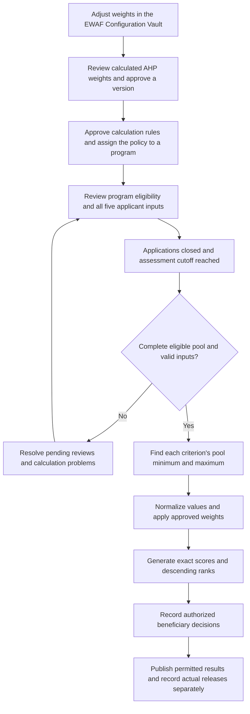

# How the current EWAF calculation and ranking work

Code reviewed: **27 October 2026**. System: **Santolan PWD Association**.

EWAF compares the verified needs of eligible applicants for the same assistance program. It combines five criterion values with approved weights, produces a score on a nominal 0–100 scale, and ranks higher scores first. Authorized staff then make beneficiary decisions within the program's available slots.

The current calculation uses **HI, SI, ES, PA and HM**. The newer SES/ES/PA/HM revision documents in the repository have not replaced these criteria in the current calculation code. This guide describes the saved implementation and the owner-confirmed SI and slider changes, rather than that proposed revision.

**1. The overall process**



“All information is complete” means that every application for the program has a resolved review outcome and every eligible applicant has current, accepted information for all five criteria. The calculation does not rank every registered member in the association automatically.

Membership verification and program requirements determine **eligibility**. EWAF calculates **priority among eligible applicants**. A high score does not replace eligibility review or automatically approve assistance.

A program with approved weights can proceed through normal publication and intake requirements while detailed scoring rules are still pending. Generating a ranking requires the complete approved calculation policy to be assigned first.

**2. The five criteria**

| Code | Criterion | Accepted value used in calculation | Direction of contribution |
| --- | --- | --- | --- |
| HI | Household Monthly Income | Average verified monthly household income, in PHP, over the approved assessment period | Lower income contributes more |
| SI | Socioeconomic Indicator | 0, 2.5 or 5 from reviewed 4Ps membership and Certificate of Indigency findings | Higher SI contributes more |
| ES | Employment Status | Accepted employment category, encoded as 1, 2, 3 or 4 | Higher code contributes more |
| PA | Previous Assistance Received | Count of qualifying successful, non-voided assistance releases in the approved scope and period | Fewer releases contribute more |
| HM | Number of Household Members | Verified positive whole-person count under the approved household definition | More household members contribute more |

Registration information and documents support the assessment, but entering a value in a member record does not by itself accept it for ranking. Staff must review the required evidence and record accepted findings under the program's assigned policy.

Disability screening and program relevance belong to eligibility review in this workflow. They do not create an additional weighted criterion or an applicant-specific bonus.

**3. How each raw value is established**

**HI — Household Monthly Income.** Staff review one income amount for each complete calendar month required by the policy. The period covers the specified number of complete months immediately before the application-closing month.

```text
HI = sum of accepted monthly household income amounts / number of months
```

For example, if an approved policy requires three months and the accepted amounts are PHP 7,000, PHP 8,000 and PHP 9,000, HI is PHP 8,000 per month. Three months is an example here, not a universal setting. The policy must define the period and which income sources, inclusions and exclusions apply. Negative or unresolved monthly amounts cannot be accepted.

**SI — Socioeconomic Indicator.** The current owner-confirmed rule is:

| Reviewed 4Ps membership | Reviewed Certificate of Indigency finding | Raw SI score |
| --- | --- | ---: |
| Yes | Yes | 5 |
| Yes | No | 2.5 |
| No | Yes | 2.5 |
| No | No | 0 |

Both findings require an explicit review. An unanswered, disputed or unverified finding is not treated as No. The system derives the SI score from the findings; staff do not type an arbitrary final SI score.

These are **raw SI values**. SI = 5 does not directly add five points to the final EWAF score. It is first normalized against the program's eligible pool, then multiplied by the SI weight.

**ES — Employment Status.** The implemented encoding is:

| Accepted category | Raw ES score |
| --- | ---: |
| Full-Time Worker | 1 |
| Part-Time Worker | 2 |
| Seasonal Worker | 3 |
| Unemployed | 4 |

An unlisted, mixed or unresolved employment category blocks usable scoring until it is resolved under an authorized policy. It is not automatically classified as Unemployed.

**PA — Previous Assistance Received.** The system counts qualifying actual releases from its assistance ledger. The policy determines whether the count covers all Association programs or this program only, and how many calendar months to review.

The date interval runs from the cutoff minus the approved number of calendar months through the cutoff, inclusive, with month-end adjustment when needed. A qualifying release must also have been recorded by the assessment cutoff. Voided releases, applications, undelivered selections, referrals and attendance do not count as delivered assistance.

PA = 0 is valid only when the required history coverage has been reviewed and supports a zero count. Incomplete history is not converted to zero. The implemented unit is a release record, not the peso value of assistance.

**HM — Number of Household Members.** Staff accept a positive whole-person count using the approved definition of a household. It is not automatically the same as number of dependents. Ambiguous living arrangements require assessment; the system does not invent a household definition.

**4. How the weight sliders work**

Weights determine each criterion's share of the final score. All applicants in one calculation use the same retained, approved weight version.

In the **EWAF Configuration Vault**:

- Each slider displays a full 0–100% scale, with 0.01 percentage-point steps.
- Increasing a criterion reduces the weights below it proportionally. Earlier weights remain fixed.
- Decreasing a criterion releases weight to the criteria below it.
- The last criterion receives the remainder, keeping the proposed total at exactly 100%.
- Priority arrows move any criterion higher or lower. Move the last criterion higher to adjust it directly.
- Feasible proposals preserve positive weights, descending priority and a highest-to-lowest ratio no greater than 9:1.

A full-scale slider does not mean one saved criterion can take the entire 100% and leave the rest at zero. The owner selected full-scale controls with Saaty-compatible final weights.

The editor restores a saved slider proposal when available. Otherwise, its document-based starting proposal is:

| HI | SI | ES | PA | HM | Total |
| ---: | ---: | ---: | ---: | ---: | ---: |
| 34.21% | 23.60% | 17.74% | 12.23% | 12.22% | 100.00% |

These are proposed percentages, not a claim about any particular program's approved weights. The editor does not force equal weights. Equal weights can still result when comparisons indicate equal importance.

**5. How a slider proposal becomes approved AHP weights**

The system converts the proposal to ten pairwise comparisons for the five criteria. It uses supported values 1 through 9 and their reciprocals. A comparison of 1 represents equal importance; larger values favor the row criterion over the column criterion.

For each pair, the system calculates the ratio of proposed weights. It chooses the supported integer with the smallest multiplicative error, using the reciprocal when the first criterion has lower weight. A distance tie favors the smaller integer. The resulting comparisons are **generated from the sliders**, rather than independently entered judgments.

The AHP calculation then follows these steps:

```text
1. Build reciprocal comparison matrix A; each diagonal value is 1.
2. Add each column: S[j] = sum of A[i,j] over all rows i.
3. Normalize each column: N[i,j] = A[i,j] / S[j].
4. Calculate each criterion weight: w[i] = sum of N[i,j] / 5.
5. Calculate the weighted-sum vector: WSV = A × w.
6. Calculate CV[i] = WSV[i] / w[i].
7. Estimate lambda_max = average of the five CV values.
8. CI = (lambda_max - 5) / 4.
9. CR = CI / 1.12.
```

Approval requires `0 <= CR < 0.10` and preservation of the proposed priority order. The consistency check concerns the generated comparisons; it does not independently validate the policy's fairness or the applicant evidence.

The Vault displays the calculated weights after an adjustment. Approval saves the calculated result after server validation. The slider percentages can therefore differ from the weights used for scoring.

For the starting proposal above, the current engine generates this matrix:

| Row / column | HI | SI | ES | PA | HM |
| --- | ---: | ---: | ---: | ---: | ---: |
| HI | 1 | 2 | 2 | 3 | 3 |
| SI | 1/2 | 1 | 1 | 2 | 2 |
| ES | 1/2 | 1 | 1 | 2 | 2 |
| PA | 1/3 | 1/2 | 1/2 | 1 | 1 |
| HM | 1/3 | 1/2 | 1/2 | 1 | 1 |

| Criterion | Proposed percentage | Calculated decimal weight, abbreviated | Vault percentage display |
| --- | ---: | ---: | ---: |
| HI | 34.21% | 0.368333333333… | 36.83% |
| SI | 23.60% | 0.206388888888… | 20.64% |
| ES | 17.74% | 0.206388888888… | 20.64% |
| PA | 12.23% | 0.109444444444… | 10.95% |
| HM | 12.22% | 0.109444444444… | 10.94% |
| Total | 100.00% | Approximately 1 at stored precision | 100.00% |

For this example, `lambda_max ≈ 5.013255811363` and `CR ≈ 0.002958886465`, so the consistency check passes. SI and ES have equal calculated weights; PA and HM also have equal calculated weights. The displayed PA/HM percentages differ by 0.01 because the display distributes rounding remainders to keep the displayed total at 100.00%. That display adjustment does not change the stored weights.

The AHP engine uses 50-digit decimal arithmetic. Ranking reuses the exact stored decimal strings without rescaling; any tiny recorded storage residue is retained. Rounded display percentages are not substituted into the scoring formula.

A new approval creates a version with its reason, actor, comparisons and provenance. Existing program configurations and earlier rankings retain their assigned versions. Earlier exact-percentage versions also retain their original calculation method.

**6. Min–max normalization of applicant values**

The criteria use different units: pesos, SI levels, employment codes and counts. Normalization converts each value to a comparable 0–1 value.

For each criterion, the system finds the minimum `L` and maximum `U` across the **complete accepted eligible pool for that program and calculation run**. These bounds do not come from all Association members or a fixed global table.

For HI and PA, where lower values contribute more:

```text
Normalized value = (U - applicant value) / (U - L)
```

For SI, ES and HM, where higher values contribute more:

```text
Normalized value = (applicant value - L) / (U - L)
```

For example, if SI values in a pool are 0, 2.5 and 5, their normalized values are 0, 0.5 and 1. If the pool contains only 2.5 and 5, those normalize to 0 and 1. Normalization is relative to that pool; the engine does not always divide SI by 5.

If `U = L` for any criterion, calculation stops. For example, if everyone has PA = 0, that PA column has no variation. The current policy does not silently assign all applicants zero or full points, remove the criterion, or redistribute its weight. A single-applicant pool also encounters this condition.

**7. Final score formula**

```text
EWAF score = 100 × (
    w_HI × normalized_HI
  + w_SI × normalized_SI
  + w_ES × normalized_ES
  + w_PA × normalized_PA
  + w_HM × normalized_HM
)
```

Each criterion's contribution in score points is `100 × weight × normalized value`. The system adds these contributions using exact rational arithmetic from the retained inputs and stored weights. It rounds the final display to two decimal places using half-even rounding. Ranking uses the unrounded exact value.

**8. Worked example using the current implementation**

The following three applicants are fictional. Assume they have passed eligibility review, all five inputs have been accepted under the same valid policy, and the calculated AHP weights from section 5 have been approved and assigned. These are demonstration assumptions, not actual member records or a newly approved policy.

| Applicant | HI, PHP/month | 4Ps | Indigency | Raw SI | Employment | Raw ES | PA releases | HM persons |
| --- | ---: | --- | --- | ---: | --- | ---: | ---: | ---: |
| A | 8,000 | Yes | Yes | 5 | Seasonal Worker | 3 | 0 | 5 |
| B | 14,000 | No | Yes | 2.5 | Unemployed | 4 | 1 | 6 |
| C | 20,000 | No | No | 0 | Full-Time Worker | 1 | 3 | 2 |

The pool bounds are:

| Criterion | Minimum L | Maximum U |
| --- | ---: | ---: |
| HI | 8,000 | 20,000 |
| SI | 0 | 5 |
| ES | 1 | 4 |
| PA | 0 | 3 |
| HM | 2 | 6 |

Applying the normalization formulas gives:

| Applicant | Normalized HI | Normalized SI | Normalized ES | Normalized PA | Normalized HM |
| --- | ---: | ---: | ---: | ---: | ---: |
| A | 1 | 1 | 2/3 | 1 | 3/4 |
| B | 1/2 | 1/2 | 1 | 2/3 | 1 |
| C | 0 | 0 | 0 | 0 | 0 |

For applicant B:

```text
HI = (20,000 - 14,000) / (20,000 - 8,000) = 1/2
SI = (2.5 - 0) / (5 - 0)                 = 1/2
ES = (4 - 1) / (4 - 1)                   = 1
PA = (3 - 1) / (3 - 0)                   = 2/3
HM = (6 - 2) / (6 - 2)                   = 1

Score B ≈ 100 × (
    0.368333333333… × 1/2
  + 0.206388888888… × 1/2
  + 0.206388888888… × 1
  + 0.109444444444… × 2/3
  + 0.109444444444… × 1
)

Score B ≈ 67.615740740741 → displayed as 67.62
```

The actual engine uses the full stored coefficients, not the abbreviated values printed here. Its results are:

| Rank | Applicant | Score before two-place display, abbreviated | Displayed score |
| ---: | --- | ---: | ---: |
| 1 | A | 90.384259259259… | 90.38 |
| 2 | B | 67.615740740740… | 67.62 |
| 3 | C | 0 | 0.00 |

Applicant A ranks ahead of B because the combined weighted contributions are greater, even though B has the higher employment code and household count. Applicant C's zero score describes their relative position in this particular pool; it does not reverse an accepted eligibility decision.

This example was checked directly against the current slider projection and operational dataset calculation functions, using fictional data and a dummy database backend. No database connection, member-data change, approval or saved ranking was required.

**9. Ranking, ties and beneficiary decisions**

The ranking rule is:

```text
Rank = 1 + number of applicants with a strictly higher exact score
```

This produces competition ranks. Scores of 90, 80, 80 and 70 receive ranks **1, 2, 2 and 4**. Two scores that display the same rounded number can still have different ranks if their exact values differ. Names, application order and identifiers do not break an exact scoring tie.

A tie crosses the capacity boundary when there are fewer remaining slots than equally ranked applicants at that boundary. For example, with two slots and ranks 1, 2, 2, only one slot remains for the two applicants tied at rank 2.

The assigned policy must specify either a hold at that boundary or an authorized human decision with a recorded tie explanation. The system does not silently select one tied applicant.

Ranking itself does not select beneficiaries. Staff record reasoned decisions within available slots. Publishing permitted results and recording actual assistance releases are separate actions. Private incomes, assessment details and evidence are not made public merely by generating a ranking.

The current operational dataset policy does **not** assign High, Moderate, Low or Minimal assistance-need bands. Historical demonstration bands are not active classifications in this workflow.

**10. What must be complete before generation**

An authorized administrator can use **EWAF Ranking → Generate EWAF Ranking** when:

1. The program has an approved, applicable calculation policy bound to the exact approved weight version.
2. Required policy details are complete: income rules and period, household definition, evidence rules, PA scope and history coverage, tie procedure, effective dates and assessment cutoff.
3. Applications have closed and the bound assessment cutoff has been reached. Input acceptance also requires that cutoff to have occurred.
4. Every application has a resolved, current review outcome. Verified ineligible outcomes remain outside the scored pool.
5. Every eligible applicant has accepted HI, SI, ES, PA and HM inputs supported by current permitted evidence.
6. No required input is missing, stale, disputed, invalid or unsupported. No criterion column is constant.
7. The policy is still effective, the scoring feature is enabled, and the operator has calculation permission.

An unresolved applicant blocks the complete-pool calculation; the system does not silently remove that person to obtain a result. Missing values are not replaced with zero, averages or maximum-need scores.

Each run retains the input snapshot, supporting review references, policy and weight versions, bounds, calculation traces and exact scores. If evidence, assistance history, program terms or the eligible pool changes, current use requires renewed review and a new calculation of the complete pool. Previous runs remain available; staff cannot manually edit an issued score or rank.

**11. Current implementation and activation status**

The navigation entry is **EWAF Ranking**. The former Revised EWAF preview entry has been retired; its old entry URL redirects to ranking. Historical records retain their original methods.

This guide documents the saved code as reviewed on 27 October. The last recorded environment validation on 26 October reported that a manual server restart was needed to load the changes and that the development database had no approved dataset scoring policy. Those are dated observations, not a fresh claim about today's running server. Deployment/loading and the program's policy approval must be confirmed in the running system before treating ranking as available for a real program.

The latest recorded focused validation passed 49 Django tests and 1,500 cascade cases. Creating this guide does not approve a policy, change the implementation milestone or alter application data.

**12. Implementation references**

| Subject | Current source |
| --- | --- |
| Criterion names, directions and employment codes | [Dataset definitions](../ewaf/revised/engine.py) |
| SI 0 / 2.5 / 5 rule | [SI scoring](../ewaf/revised/si.py) |
| Accepted income, SI, employment, PA and household inputs | [Evidence and input assessment](../ewaf/revised/live_evidence.py) |
| Slider behavior | [Weight slider controls](../static/js/ewaf-weights.js) |
| Slider ratios and generated comparisons | [Weight projection](../ewaf/weight_input.py) |
| Five-criterion AHP calculation and consistency | [Household AHP arithmetic](../ewaf/household_math.py) |
| Versioned Vault approvals | [Vault services](../ewaf/vault_services.py) |
| Policy choices, compatible weights and classifications | [Dataset policy contract](../ewaf/revised/contracts.py) |
| Policy approval and program binding | [Dataset policy services](../ewaf/revised/live_services.py) |
| Operational normalization, contributions and exact ranks | [Live dataset calculation](../ewaf/revised/live_math.py) |
| Generation gates and beneficiary decisions | [Operational services](../ewaf/operational_services.py) |
| Recorded validation and limitations | [October 26 validation](ewaf-document-ranking-2026-10-26-validation.md) |

The recorded computation reference is `EWAF_Computation_Download/Computation_Updated_HI_SI_ES_PA_HM.docx`. That original path was absent from this checkout during this documentation review; the formulas and example above were verified against the current code. The newer `Computation_Updated_SES_ES_PA_HM.docx` is a different revision and is not substituted for the implemented method in this guide.
