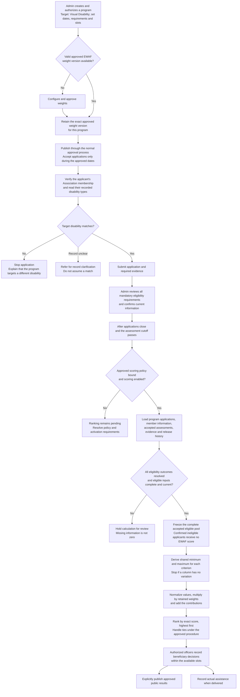

# EWAF ranking workflow

Prepared 26 October 2026. Example: an assistance program targeting **Visual Disability**.

The flow is: **create the program → retain approved weights → open applications → verify membership and disability match → review eligibility and evidence → close applications → calculate scores under an approved policy → rank eligible applicants → officers select beneficiaries → publish approved results and record actual assistance separately.**

Weights describe how much each criterion contributes to the score. Applicant information supplies the values evaluated under those criteria. The system does **not** calculate new weights from each applicant's registration record.

This guide explains the **HI / SI / ES / PA / HM dataset method**. The October 26 follow-up replaces the Revised EWAF preview entry with the operational **EWAF Ranking** workflow. Adjust the cascading sliders in the **EWAF Configuration Vault**, approve their calculated Saaty weights and the calculation rules, assign the approved policy to a program, and complete the accepted-input reviews before generating its ranking. Older calculations retain their original methods. See the [current validation and scope](ewaf-document-ranking-2026-10-26-validation.md); the earlier [publication decision](weights-publication-2026-10-25/validation.md) and [dataset integration validation](dataset-policy-integration-2026-10-25/implementation-validation.md) remain historical evidence.

The owner confirmed the SI rubric in this follow-up: **5** for both verified 4Ps membership and a Certificate of Indigency, **2.5** for either one, and **0** for neither. Staff must explicitly review both findings. An unanswered or disputed field remains incomplete. SI is then normalized within the eligible pool before its weighted contribution is calculated.

The owner confirmed full-scale sliders with Saaty-compatible final weights. Every slider displays 0–100%; feasible values preserve positive weights, priority order and the 1–9 comparison scale. Increasing a criterion keeps earlier weights fixed and reduces the weights below it proportionally. The last criterion receives the remainder to 100%; move it higher with the arrows to adjust it. Starting suggestions use the document's unequal percentages when no usable saved vector exists. Equal importance remains a valid Saaty comparison.

The Vault shows the calculated AHP weights after each adjustment. These can differ from the slider proposal because its ratios are converted to supported discrete comparisons. Approval stores the displayed calculation at full precision, its generated-comparison provenance, reason and actor in a new version. These are slider-derived comparisons, not independently entered pairwise judgments. Earlier exact-percentage and AHP versions, assigned program configurations and existing scores remain unchanged.



**1. Create the program and define who can apply.**

For your “program for blind applicants” example, suppose the configured target is **Visual Disability**. The system compares that target with the disability classifications in the verified member record. It does not infer a narrower blindness-only requirement from the program title.

| Verified member record | Disability screening outcome |
| --- | --- |
| Visual Disability | Passes this requirement; other eligibility requirements still apply. |
| Hearing Disability only | Cannot proceed because there is no matching target disability. |
| Visual Disability plus another classification | Passes because at least one active classification matches. |
| Missing, inactive or unclear classification | Requires record clarification before proceeding. |

The mismatch message begins: “You cannot proceed with this application because the disability types in your verified member record do not match this program's target disability types.” A failed match is an eligibility restriction, not a low EWAF score. Having multiple disability classifications does not add weighted points in this method. [Disability screening implementation](../programs/application_workflow.py)

**2. Check whether approved weights already exist.**

If an applicable approved configuration exists, retain its exact version for the program. If it does not, the authorized Admin must configure and approve one. All applicants in the same calculation use the same retained weights. A later shared configuration does not silently change an existing program's weights.

There are two separate readiness checks:

| Check | What it allows |
| --- | --- |
| Approved weights and all normal program publication requirements | Publication and applications during the approved schedule, even while numerical scoring rules are pending. |
| Complete approved scoring policy, correct program binding, scoring enabled, closed application period and ready evidence | Official calculation and ranking. Weights alone are insufficient. |

Scoring rules define how evidence becomes a value, which direction increases priority, how normalization works, and how exceptional cases are handled. Approval of percentages does not approve those rules. [Recorded publication decision](weights-publication-2026-10-25/validation.md)

**3. Retrieve and verify the information used for scoring.**

The system starts from this program's submitted applications and their linked member records. Authorized reviewers confirm current information and supporting evidence. Registration approval by itself does not make every field an accepted scoring input.

| Criterion | Information used by the revised method |
| --- | --- |
| **HI — Household Monthly Income** | Accepted household income findings for the policy's assessment period, supported by current evidence. |
| **SI — Socioeconomic Indicator** | Explicitly reviewed 4Ps membership and Certificate of Indigency: both = 5; either one = 2.5; neither = 0. Unknown is not No. |
| **ES — Employment Status** | The accepted employment category, converted using the policy's category mapping. |
| **PA — Previous Assistance Received** | Qualifying confirmed, non-voided actual release records within the approved scope and period, with verified history coverage. Applications or selections without delivery do not count as releases. |
| **HM — Number of Household Members** | The accepted household count under the policy's household definition. This is different from historical Number of Dependents. |

Missing, stale, disputed or unverified information holds the calculation for review. An empty assistance history cannot automatically be treated as zero unless its coverage is established. A person awaiting evidence review is not automatically ineligible. [Input acceptance implementation](../ewaf/revised/live_evidence.py)

**4. Freeze the eligible pool and calculate shared normalization bounds.**

Official calculation waits until applications close and the bound assessment cutoff has passed. All in-scope eligibility outcomes must be resolved. Confirmed ineligible applications are excluded with their review outcome retained; the system must not silently drop unresolved applications to produce a ranking.

For the dataset method, the minimum and maximum for each criterion come from the **complete accepted eligible applicant pool for that run**. They are not fixed limits invented before applications open. The run retains its inputs, evidence versions, policy, weights and bounds so its result can be reproduced. [Calculation workflow](../ewaf/operational_services.py)

**5. Apply the weights — worked example.**

The following weights and fictional applicant values preserve the document's original worked example. They are **example assumptions, not a claim about a program's approved configuration**. In particular, its SI values of 4, 3 and 1 are historical illustrative inputs; new policies use the owner-confirmed 0, 2.5 and 5 rubric above. [Example provenance](ewaf-revised-2026-10-25/README.md)

| Criterion | Example weight | Example direction |
| --- | ---: | --- |
| HI | 34.21% | Lower income produces a higher normalized value. |
| SI | 23.60% | A higher accepted SI value produces a higher normalized value. |
| ES | 17.74% | A higher encoded employment value produces a higher normalized value. |
| PA | 12.23% | Fewer previous releases produce a higher normalized value. |
| HM | 12.22% | A larger household produces a higher normalized value. |
| **Total** | **100.00%** | |

These directions require policy adoption before operational use. The example employment mapping is Full-Time Worker = 1, Part-Time Worker = 2, Seasonal Worker = 3, and Unemployed = 4. An unlisted category must be resolved, not automatically mapped to unemployed.

Assume A, B and C all pass the Visual Disability requirement and every other mandatory eligibility check:

| Applicant | HI in PHP/month | SI | ES | PA | HM |
| --- | ---: | ---: | --- | ---: | ---: |
| A | 5,000 | 4 | Seasonal Worker → 3 | 1 | 4 |
| B | 12,500 | 3 | Unemployed → 4 | 0 | 2 |
| C | 20,000 | 1 | Full-Time Worker → 1 | 3 | 6 |

The resulting minimum–maximum pairs are HI **5,000–20,000**, SI **1–4**, ES **1–4**, PA **0–3**, and HM **2–6**. Each applicant uses those same bounds.

```text
For HI and PA in this example:
normalized value = (maximum - applicant value) / (maximum - minimum)

For SI, ES and HM in this example:
normalized value = (applicant value - minimum) / (maximum - minimum)

Score out of 100 = 100 × sum(decimal weight × normalized value)
```

If a criterion has the same value for everyone, its maximum equals its minimum. The implemented dataset calculation stops for that condition; it does not divide by zero or invent replacement scores.

| Applicant | Normalized HI | SI | ES | PA | HM |
| --- | ---: | ---: | ---: | ---: | ---: |
| A | 1 | 1 | 2/3 | 2/3 | 1/2 |
| B | 1/2 | 2/3 | 1 | 1 | 0 |
| C | 0 | 0 | 0 | 0 | 1 |

For applicant A:

```text
Score = 100 × [(0.3421 × 1)
             + (0.2360 × 1)
             + (0.1774 × 2/3)
             + (0.1223 × 2/3)
             + (0.1222 × 1/2)]
      = 83.90
```

The calculations retain full precision internally. Rounding to two decimal places is for display, not ranking. [Example inputs](../ewaf/revised/fixtures.py), [dataset calculation](../ewaf/revised/live_math.py)

**6. Rank applicants and make a separate selection decision.**

| Applicant | Displayed score out of 100 | Internal rank |
| --- | ---: | ---: |
| A | 83.90 | 1 |
| B | 62.81 | 2 |
| C | 12.22 | 3 |

If the program has two slots, A and B lead this example ranking. Authorized officers must still record beneficiary decisions; the score does not automatically approve anyone. Slots limit beneficiary selection rather than stopping intake after the first two applications.

The revised implementation supports competition ranking: exact ties share a rank, such as **1, 2, 2, 4**. A tie across the last available slot must follow the approved tie procedure or remain on hold. Submission order, names and rounded display scores do not secretly break a tie. The ranking convention and tie procedure require the applicable policy's approval. [Decision and capacity controls](../ewaf/operational_services.py)

**7. Publish results and record delivery through separate actions.**

After beneficiary decisions are complete and current, authorized staff can explicitly publish the allowed public results. Private scoring inputs and evidence do not become public merely because results are published. A selected applicant has not yet received assistance: an actual release is recorded when delivery occurs, and qualifying releases can inform PA in later evaluations.

If accepted information or the eligible pool changes, review the change and create a new authorized calculation using newly derived bounds. Retain the earlier run and review any affected decisions or publication. Never repair the ranking by typing over individual scores or ranks.

The worked example was reproduced using the database-free revised calculation engine with classifications disabled. Its weights sum to 1, and the exact scores before display rounding are A = **839/10**, B = **7537/120**, and C = **611/50**. No member data, configuration approval or operational ranking was created to prepare this guide.
