# G18-B Gate 2A verified writer and lock graph

Design review only, 2026-10-18, local `feature/events`. **70% remains accepted.**
Read with the [finalized proposal](g18-b-gate2a-design-2026-10-18.md).
Verification here means static inspection of the current Python call paths and
installed Django **5.2.17** source, not a new database concurrency test or a claim
that the proposed locks already exist. Gate 1's 999-test report remains historical
test evidence. No writer or installed-library file was edited.

## Notation and evidence

`L(X)` means explicit `select_for_update`; `W(X)` means implicit write/FK/index
locking, which is also relevant to deadlocks. T is `ProgramTermsLock(1)`;
H is the proposed global AuthorityGeneration row; P/S are Program/source state;
V is linked Event; A is ProgramApplication; M is Member; I is membership intake;
E is EligibilityStatus. New rows do not exist to prelock: insert only after their
existing parent/reference locks, under T. Ordinary reads do not imply row locks.

Source anchors are repository-relative; line numbers identify this reviewed
checkpoint and must be refreshed if implementation changes the source.

| Writer family / entry points | Verified CURRENT transaction and lock edges | Mandatory proposed integration / scope |
|---|---|---|
| Membership `services.py:25` submit | atomic -> L(MembershipSettings) -> W(new I/documents/MembershipEvent); file writes and failure cleanup | T,H first; settings/requirements resolved under fence before form snapshot acceptance. No candidate scope until Member/program application exists. Preserve submission retry and cleanup. |
| Membership `services.py:60,70,90` verify/decide | atomic -> L(pending I); verification W(I,event); approval W(new M), W(I,event). Finalized intake rejected. | T,H; resolve any existing member/program scope before locking I; existing M before I, only new M inserted after I. Preserve pending-only rule and audit. No invented reversal service. |
| Members `services.py:15,22,48` update/status | atomic -> L(M) -> W(M,MemberEvent); displayed version check | T,H -> affected P,S,V,A -> M; every program containing that member, including archived/final applications. Same transaction increments all scope generations. |
| Documents `services.py:49` verify | atomic; read document/intake -> L(M) -> W(new verification,MemberEvent); Member.version need not change | T,H -> all member programs/scope -> M -> document rows. Re-resolve lineage under fence. Review ID and immutable audit retained. |
| Programs `services.py:91,135,179` save/publication/requirements | `@terms_lock()` outside atomic -> L(P); writes requirements/M2M/version/ProgramLog; protected term forms reject major changes | Add H before P; source state/linked-event order follows graph. Scope one program; creation initializes state after P insertion. Preserve term/PDAO guards. |
| Programs `services.py:211` submit | T -> atomic -> L(P) -> L(M) -> allocate reference -> W(new A/doc/photo/log). `workflow.py:14`: optional L(ProgramCodeCounter); ReferenceCounter get/create/update serialized by P, not explicit `select_for_update` | T,H,P,S,V -> existing A if relevant -> M -> counters -> new A/evidence. Inventory generation advances for every new retained application, including after cutoff. Duplicate submission does not fabricate an invalidation. |
| Programs `services.py:268` close application | atomic -> L(P) -> L(A) -> W(A,case,AssistanceLog,ProgramLog); no explicit M lock | T,H,P,S,V,A,M then case/reference leaves. Scope one program. No new status transition. |
| Programs `workflow.py:57,84,124` photo/correction | atomic -> L(P) -> locking A query with `select_related('current_photo')` -> L(M); W(A/photo/review/doc/revision/case/audits). Joined photo can be locked along with A; it is not a guaranteed A-only lock. | T,H,P,S,V -> lock A alone -> M -> photo/doc leaves. Remove joined locking read during later authorized refactor; fetch/lock photo explicitly after M. Preserve prior files/reviews and correction deadlines. |
| Assistance `services.py:34,80` eligibility | atomic -> L(P) -> L(A) -> L(M) -> L(E) -> W(case,A,AssistanceLog) | T,H -> one P/S/V/A/M -> E/case; increment program generation with eligibility audit. |
| Assistance `services.py:159` decision | helper L(P), L(A), **all program M ordered PK only when permission is `assistance.decide_assistance`**, then target M; `require_current_review` locks E; W(case,A,audit) | T,H and prefix; precompute complete M set in order; no late lower-key M acquisition. EWAF decisions remain refused by retired ranking gate. |
| Assistance `services.py:205` receipt | atomic -> L(P) -> L(A) -> L(target M) -> L(E) via current review -> W(receipt,A,audit) | T,H -> ALL affected programs for member, ordered before A/M; generation fan-out includes programs other than receipt's program. |
| Assistance `services.py:243` void | atomic -> L(P) -> L(A) -> L(target M) -> L(receipt) -> W(receipt,case,A,audit). No explicit E lock in this path. | Same cross-program prefix; prelock E if needed before receipt under unified leaf order, then receipt. Never acquire another P after M. |
| EWAF evidence `evidence_services.py:36,46,67,136` | T -> L(P); assessment/readiness additionally L(A),L(M); immutable artifact/ProgramLog persistence | H and source state added before existing source locks. Policy/assessment AND retained readiness audit writes invalidate conservatively because Gate 1 tokens include source audit IDs. Avoid a silent dependency projection change. |
| EWAF configuration `configuration_services.py:36,63,91,112,123` | T -> L(P); validation/review/reference reads lock selected configuration, then validation where used; immutable artifacts + protected ProgramLog | H,S and prefix; same-program generation increment for configuration, validation, review or authority-evidence records. These records still do not approve operations. |
| EWAF scoring `scoring_services.py:30,64` | T -> L(P); diagnostic uses L(A),L(M), then assessment locks in criteria order; immutable diagnostic graph + ProgramLog | H,S/prefix; scoring-policy and diagnostic audit writes invalidate conservatively. Prelock assessment rows by PK rather than discovered criterion order. Numerical engines unchanged. |
| Program approval `approval_services.record_pdao_approval`; binding `binding_services.py:23,54` | T -> L(P), then immutable approval/terms/binding + ProgramLog; control get/create/save has implicit write locks, **not an explicit control SELECT FOR UPDATE** | H,S/prefix; explicit control leaf lock in integration. Preserve offline approval semantics and all PDAO settings. |
| Events `services.py:84,133` save/publication | T -> L(V); W(event/version/EventLog); guards read linked P; save may change unprotected link | Under T,H, read old/proposed links without locking V first; lock union of old/new P,S sorted, then V, before mutation. Invalidates linked program(s), never attendance scores. |
| Document/reference/admin paths | `MembershipDocumentRequirementAdmin`: Django change-form transaction, W(requirement), LogEntry; no T. DocumentType/DisabilityType `clean/save` and protected queryset operations acquire T internally; late guard entry does not fence the whole admin operation. Deletes denied in these admins. | Outer admin POST fence before validation/save/M2M/logging; T,H -> affected P,S,V,A,M -> reference leaf. Requirements/DocumentType changes conservatively invalidate every registered development program; classifications cover program qualification or member usage. Existing guarded queryset/bulk operations must join service or reject when not inside an authorized writer context. |
| Auth user/group admin (`accounts/admin.py:6,25,34`) | Superuser-only permission methods, otherwise stock UserAdmin/GroupAdmin; no generation service, no whole-action T fence | Whole mutating POST T,H before user/group save/M2M/cascade/audit; global authority generation, no program fan-out. See auth path table below. |
| Gate 1 durable `durable_services.py:68,218` | T -> L(P) -> L(all A PK) -> L(distinct M PK) -> L(all E PK). Intent, graph, failed outcome are separate transactions. Graph audit FKs also lock actor/parents implicitly. | New generation-aware service uses T,H,P,S,V,A,M,E/leaves; existing helpers may only run inside verified owned context. Historical request/run digest formats unchanged; new sidecars carry generations. |

**Corrections to the Gate 1 matrix:** the all-members Assistance lock is a
decision-only branch, independent of `ewaf_applicable`; release/void do not execute
that branch. Void does not explicitly lock E. Approval controls and reference
counters have implicit writes where the earlier outline was less precise. The
Gate 1 documents remain unchanged as historical review artifacts.

## Authentication paths and transaction boundaries

Installed source inspected: Django `contrib/admin/options.py` lines 1311/1333,
1839, 2014, 2205; `contrib/admin/actions.py:19`; `contrib/auth/admin.py:155`;
`contrib/auth/apps.py:18`; `contrib/auth/models.py:18`.

| Path | Current behavior | Selected treatment |
|---|---|---|
| User/group add/change POST | Stock change-form transaction covers save_model, save_related/M2M and admin log | Wrap the complete outer POST, re-fetch/re-authorize actor under T,H; one authority event for the successful action, including M2M changes. A save_model-only hook is insufficient. |
| Single delete POST | Stock delete_view uses atomic, logs deletion and deletes | Fence before collector/validation/mutation; preserve PROTECT failures. Event records target label/ID, not a target FK that prevents otherwise allowed deletion. |
| Bulk delete action | `delete_selected` calls `log_deletions` **before** `delete_queryset`; wrapping delete_queryset alone misses audit atomicity | Fence the action/changelist POST from before logging through deletion, including rollback. Confirmation GET has no mutation. |
| Admin password set/unset POST | `UserAdmin.user_change_password` has a distinct save/log/session path; no whole-method atomic block in inspected method | Explicit separate outer wrapper T,H and DB transaction; generation/audit commit with password write. Session hash/message updates after successful DB work, not source invalidation deferred to on_commit. Never retain secret/hash values. |
| Own password change | `accounts/views.py:10` currently calls superclass save/session behavior then SecurityEvent separately | Later explicit service/view integration: credential mutation + SecurityEvent + authority event atomic; preserve UI/session behavior. Failed audit cannot leave changed password committed. |
| Login, logout, throttles, last_login | StaffBackend extends ModelBackend; active+staff checks. LoginWindow counters and SecurityEvent; Django updates last_login | Not authority changes; no generation bump, no T. They do not subsequently enter the generation fence while holding these row locks. Existing behavior preserved. |
| Automatic password-hash algorithm upgrade | Django password check can rewrite a hash without changing the credential or permissions | Excluded maintenance write; not a secret/role change. Any new custom backend/signal requires coverage review. |
| Permission catalog / createsuperuser / changepassword / shell imports | Management/framework paths bypass admin; post_migrate creates permissions; no app service fence | During fresh test setup, run before audited epoch bootstrap. Once a generation-aware development session exists, use separately authorized fenced wrappers or suspend/reset that disposable session through an audited epoch change before resuming. Raw commands are not claimed integrated. |

## Final proposed order and conflicts

```mermaid
flowchart LR
  T[Terms singleton] --> H[Global authority generation]
  H --> P[All affected Programs by PK]
  P --> S[All source-state rows by Program PK]
  S --> V[Linked Events by PK]
  V --> A[Existing Applications by PK]
  A --> M[Distinct Members by PK]
  M --> L[Ordered remaining source rows]
  L --> G[Graph and immutable audit writes]
  G --> C[State CAS and commit]
```

Branches may omit unused levels but cannot return to an earlier level. Under T,
resolve scope BEFORE any P lock; do not first lock the originating program then
discover smaller program IDs. All P rows are locked before all S rows. Leaves,
when needed, are ordered: MembershipSettings, existing intake, E, approval control,
DocumentType, membership requirement, DisabilityType, ProgramRequirement,
configuration, validation, assessment, membership document, document verification,
ProgramDocument, ApplicationPhoto, PhotoVerification, AssistanceCase, receipt,
ProgramCodeCounter, ReferenceCounter. Within each table use PK order. Newly inserted
rows/references follow their existing parents. Existing immutable history is read
without unnecessary new row locks; protected audit insert/FK effects are documented
in tests. Auth mutation branch is T,H -> sorted Users -> Groups -> Permissions ->
through rows, then audit. All branches share T; no source lock is held before T.

| Conflict / gap | Resolution and required proof |
|---|---|
| M-first profile/document writer later calls new invalidation(T/P), while capture holds T/P waiting for M | Move fence to outer service entry, BEFORE M. Never append an invalidation call under pre-existing M-only lock. Race both directions. |
| P-origin-first receipt later fans out to another lower-key P | Resolve full program union under T, acquire all P sorted before A/M. Include opposite-program, same-member races. |
| Event-first save then new P lock vs P-first capture | Read linkage under T; P/S before Event. No mutation/lock of Event before scope resolution. |
| Event registration restoration currently locks Event -> registration -> Member without T | Put Event BEFORE Member in the proposed graph. This avoids creating an M->Event cycle and needs no registration writer change. Attendance/registration are not EWAF inputs. Test this competing lock path. |
| Photo joined locking query can lock photo before Member | Split A-only lock and later explicit photo lock. SQL-query inspection plus two-connection test, not inference from Python line order. |
| Admin scalar/M2M/delete/audit work split across hooks | Outer operation fence; validate complete before/after authority state and retain native audit references before commit. Injection failures in each hook must roll back all parts. |
| Callers already inside arbitrary atomic blocks | New public generation services reject unowned outer transactions. Only verified fence-owning internal adapters may nest. Admin wrapper establishes ownership before its inherited transaction; never enter after arbitrary row locks. |
| FK locks on User during result persistence | All authority mutations acquire T,H first. Login/last_login can cause finite waits but does not acquire T afterward. Test real FK behavior; do not simulate it solely with mocks. |
| Partial deployment with unfenced writers | No current promotion capability until all listed participating integrations pass. T alone does not serialize an unfenced writer. Deadlock/timeout rolls back; bounded retries restart the entire transaction with fresh scope/versions. |

Adjacent non-source paths inspected: `announcements.results.lock_program` uses
P -> ordered M -> Announcement; publication records AnnouncementEvent, not
ProgramLog. It does not acquire T afterward. `refresh_existing_results` is a no-op.
Event attendance/registration, login throttle and unrelated observance writes do
not change the EWAF dependency envelope. They need contention tests, not invented
source invalidations or changes to accepted UI/publication behavior.

This is a verified **static** graph, including identified implicit locks and
remaining runtime proof obligations. No claim of measured deadlock freedom is made.
